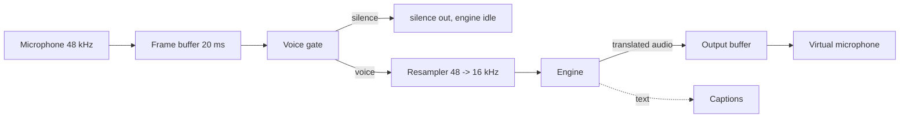

<p align="center">
  
</p>

<p align="center">
  <b>Real-time voice translation that keeps your voice and never leaves your machine.</b>
</p>

<p align="center">
  <a href="LICENSE"></a>
  
  
  
  <a href="ROADMAP.md"></a>
</p>

> **Status: v0.1 prototype.** The audio pipeline, latency budget, engine boundary, and CLI are working and tested. Speech-to-speech model inference is not wired up yet: `parlo` currently runs an echo engine so the latency and pipeline behaviour can be measured honestly. Nothing here claims to translate audio today.

---

## Why

You speak your language. The other person hears it in theirs, in your voice. No cloud, no account, no API key, no audio leaving the laptop.

Existing tools force a trade-off:

| | Cloud tools | Local tools today | Parlo |
|---|---|---|---|
| Audio leaves your machine | Yes | Sometimes | **No** |
| Account or API key needed | Yes | Often | **No** |
| Your own voice preserved | No | Rarely | **Target** |
| Works with any app | No | Sometimes | **Yes, via virtual mic** |
| Open source | No | Yes | **Yes, MIT** |

## What exists today

| Component | State |
|---|---|
| Streaming pipeline: 20 ms frames, voice gate, resampler, engine boundary | Working, 25 tests |
| CLI: `doctor`, `demo`, `translate`, `mic` | Working |
| WAV in / WAV out with honest sample-rate handling | Working |
| Latency budget and target checks | Working |
| Virtual microphone: `parlo mic setup`, `status`, `remove` on PipeWire | Working on Linux |
| macOS and Windows virtual microphone | Documented setup only |
| Engine sidecar protocol (JSON lines over stdio) | Working, wired to the CLI via `--engine sidecar` |
| Hibiki-Zero inference | Not wired yet |
| Desktop app | Not started |

The repository is built so the hard, boring parts are already correct: fixed frame sizes, bounded buffers, no hidden allocations per sample, no dependency drift, and a latency number you can inspect instead of a marketing claim.

## Try it in 20 seconds

Requires Rust 1.83 or newer. No other dependency.

```bash
cargo run --release -p parlo-cli -- doctor
cargo run --release -p parlo-cli -- demo out/demo.wav
cargo run --release -p parlo-cli -- translate out/demo.wav out/translated.wav
```

`doctor` prints the real capture format, the engine format, and the latency budget against the 3 second target:

```text
parlo 0.1.0 doctor

platform          windows x86_64
capture format    48000 Hz mono, 20 ms frames
engine format     16000 Hz mono
engine            echo (no model installed)

latency budget
  capture            20 ms
  engine           1500 ms
  output              5 ms
  total            1525 ms (target 3000 ms)

status            within target
privacy           local only, no network calls, no telemetry
```

`demo` synthesises 2.5 seconds of speech-like audio, pushes it through the pipeline in 10 ms chunks, and reports how many frames were voiced and how long the translated stream is. No microphone or model required.

To drive the real Python sidecar instead of the echo engine:

```bash
cargo run --release -p parlo-cli -- translate out/demo.wav out/sidecar.wav --engine sidecar
```

Without model weights installed this stops with the sidecar's own error message (`torch is not installed`), which is the honest result, not a crash.

## How it works



The engine is a trait, not a hard-coded model:

```rust
pub trait Engine: Send {
    fn id(&self) -> &str;
    fn target_languages(&self) -> &[&str];
    fn latency_ms(&self) -> u32;
    fn process(&mut self, input: &Frame) -> Result<EngineOutput, EngineError>;
}
```

Anything that can consume 16 kHz mono frames and return frames plus optional text can drive Parlo: Hibiki-Zero locally, a cascade of STT + translation + TTS, or a bring-your-own-key cloud engine that is off by default.

Read [docs/ARCHITECTURE.md](docs/ARCHITECTURE.md) for the frame budget and [docs/ENGINES.md](docs/ENGINES.md) for the adapter contract.

## Languages

Speech-to-speech models are the constraint, not the app.

| Direction | Engine | State |
|---|---|---|
| Portuguese, Spanish, French, German, Italian → English | Hibiki-Zero | Planned for v1.0 |
| Any → any | Cascade (STT + MT + TTS) | Planned for v1.5 |
| English → Portuguese | Cascade | Planned for v1.5 |

The honest limitation: Hibiki-Zero translates **into English only**. Portraying this as a universal translator would be a lie, so [docs/LANGUAGES.md](docs/LANGUAGES.md) says exactly what works when.

## Privacy

- No network calls in local mode. No telemetry, no crash reporting, no accounts.
- The core crate has zero dependencies, so `cargo tree` is short enough to audit in seconds.
- Audio is never written to disk unless you pass an output path.
- The app tells you when system audio capture is active, and never records silently.

Full details, including how to verify these claims yourself: [docs/PRIVACY.md](docs/PRIVACY.md).

## Repository layout

```text
crates/parlo-core       audio format, resampler, ring buffer, voice gate, pipeline, wav
crates/parlo-cli        the parlo binary
engines/hibiki          reference sidecar adapter and protocol tests
docs                    architecture, engines, languages, privacy, troubleshooting
```

## Build and test

```bash
cargo fmt --all --check
cargo clippy --workspace --all-targets -- -D warnings
cargo test --workspace

cd engines/hibiki && python -m unittest discover -s tests
```

CI runs the same commands on Linux, macOS, and Windows.

## Roadmap

Short version: v0.1 prototype (now), Hibiki inference plus real latency measurements, signed installers, virtual microphone, then two-way translation.

Full detail and exit criteria: [ROADMAP.md](ROADMAP.md).

## Contributing

Issues and pull requests are welcome. Start with [CONTRIBUTING.md](CONTRIBUTING.md), and look for `good first issue` labels: adding a hardware report, translating the README, or testing a new calling app are all genuinely useful.

## Credits

The speech-to-speech approach stands on [Hibiki-Zero](https://github.com/kyutai-labs/hibiki) by Kyutai. Parlo is an independent product and is not affiliated with Kyutai.

## License

MIT. See [LICENSE](LICENSE).
