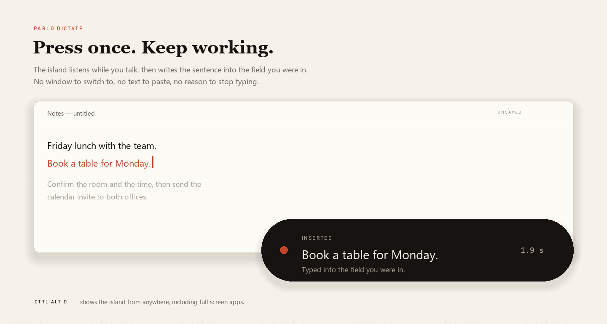
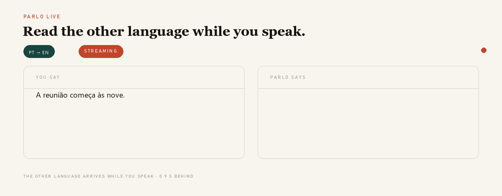
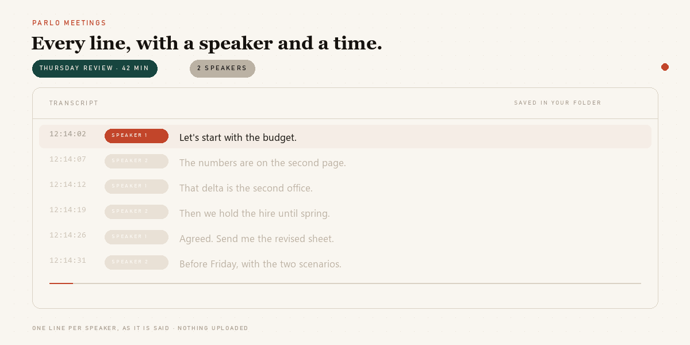
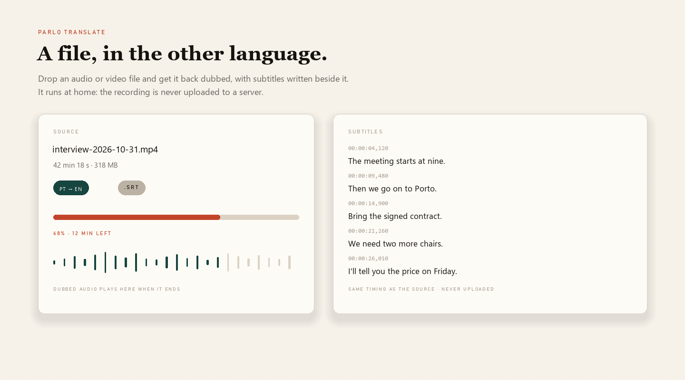
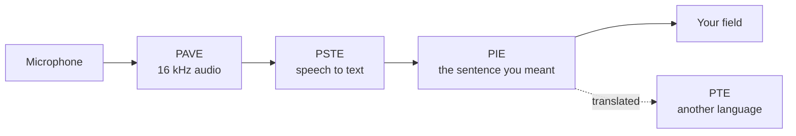

<p align="center">
  
</p>

<p align="center">
  <br>
  <b>Parlo turns speech into clean text, and text into another language, on your own computer.</b><br>
  Windows, macOS and Linux. No account, no telemetry, no subscription.
</p>

<p align="center">
  <a href="https://github.com/PedroNascimento09/Parlo/actions/workflows/ci.yml"></a>
  
  
  
</p>

You press one shortcut, speak, and the sentence appears in the field you were already in — typed, not pasted, because Parlo remembers which window had the focus. What gets written is what you meant, not what you said: a correction after "I mean" replaces the words it corrects, hesitations and false starts disappear, and the sentence you actually spoke is kept beside the result.

```text
Ctrl+Alt+D  →  "Book a table for Friday, I mean, for Monday."
            →  Book a table for Monday.
```

## Introducing Parlo

Four surfaces, one engine underneath, all four in the current release.

### Parlo Dictate

<p align="center">
  
</p>

One shortcut from anywhere on the desktop. The island listens, the sentence is written into the field you were in, and the window you were typing in never loses the cursor.

### Parlo Live

<p align="center">
  
</p>

Text while you speak: partial words appear as they are recognised, the sentence is kept once it closes, and a translation can follow in the second column when a language pair is installed.

<details>
<summary>Text of the Live animation</summary>

Two sentences are spoken in turn. Words appear one by one as they are recognised; when a sentence closes it is cleaned, punctuated and kept, and the counter at the top goes from `KEPT 0` to `KEPT 2`. Nothing is uploaded.

</details>

### Parlo Meetings

<p align="center">
  
</p>

A recording becomes a transcript with a speaker and a time on every line. A transcript from a file you already have goes through the same view, and nothing leaves the machine either way.

<details>
<summary>Text of the Meetings animation</summary>

Six lines of a recorded meeting arrive in order, each with a timecode and a speaker label, `SPEAKER 1` or `SPEAKER 2`. The newest line is highlighted, the rest of the transcript is already outlined, and the progress rail at the bottom grows with the recording. The transcript is saved in your folder.

</details>

### Parlo Translate

<p align="center">
  
</p>

A recording comes back dubbed, with subtitles timed to the source written beside it. One sentence goes through the same engine without a file.

## What it does

| In the window | What it gives you |
|---|---|
| **Dictate** | One shortcut, anywhere: the island listens, and the cleaned sentence is typed into the window you were in. **61.9 µs** of rules, no model, no network. |
| **Live** | Keeps listening in windows of about 2.5 s, translates each one and speaks it in order, without overlapping. |
| **Translate a file** | Drop a recording and get it back dubbed, with subtitles timed to the source beside it. |
| **Meetings** | Records the room or imports a transcript; every line keeps its time and its speaker, speakers can be renamed, and the whole transcript stays in your folder. |
| **Your words** | A local vocabulary fixes the names the recogniser keeps missing, before any model reads the sentence. |
| **Engines and keys** | Rules only, a model on this machine, or your own cloud key — kept in DPAPI, the macOS keychain or the Linux secret service, never in a config file, a log or an error message. |
| **Memory** | Loaded models are released after 10 minutes to 4 hours of silence, or never, your choice. |
| **Models** | One row per model with its size on disk and its own **Download** or **Remove** button; removing is real, and the feature that needed it says so before it is used. |
| **Updates** | The latest release is offered with its notes and one button; the running copy is replaced, never uninstalled first. |

## Install

**Windows, one click.** Download `Parlo-Setup.exe` from [Releases](https://github.com/PedroNascimento09/Parlo/releases/latest) and double click it. Parlo is installed in your user folder, appears in the Start menu and opens by itself. If Windows says *Windows protected your PC*, choose **More info**, then **Run anyway**: the build is unsigned, and that warning appears once.

**Windows, one line**, if you would rather not download a file: press Start, type `PowerShell`, press Enter, paste this line and press Enter again:

```powershell
irm https://raw.githubusercontent.com/PedroNascimento09/Parlo/main/scripts/install.ps1 | iex
```

Parlo appears in the Start menu. **macOS and Linux**, in any terminal:

```bash
curl -fsSL https://raw.githubusercontent.com/PedroNascimento09/Parlo/main/scripts/install.sh | bash
```

**Without a terminal.** Download the archive for your platform from [Releases](https://github.com/PedroNascimento09/Parlo/releases/latest), right-click it, **Extract All**, and double-click `parlo-app`. Windows shows *Windows protected your PC* once because the build is unsigned: **More info**, **Run anyway**. Nothing needs an administrator password, and nothing else is installed.

```text
parlo-windows-x86_64.zip      parlo-macos-aarch64.tar.gz      parlo-linux-x86_64.tar.gz
```

The installer is a **5 MB** window that downloads the **72 MB** program once and installs **187 MB** into your user folder. The first run then opens the window with no models: the Models panel has one **Download models** button and fetches about 800 MB once. After that the machine can stay offline for good.

**Updating is not reinstalling.** Parlo checks the latest release when it starts, shows its notes in a slim banner and offers one **Install update** button. Nothing installs without that click, and no version is ever installed by uninstalling the old one. Step-by-step, with what each error means: [docs/INSTALL.md](docs/INSTALL.md).

**From source** — Rust 1.85 or newer, nothing else.

```bash
cargo build --release -p parlo-cli -p parlo-app
target/release/parlo-app
```

## The path

<p align="center">
  <br>
  <sub>Animated by <code>tools/brand.py</code>: a diagram of the real path, not a screen recording.</sub>
</p>

In words: the microphone captures **audio**, a model turns it into **text**, the rules clean up what you said into **the sentence you meant**, and that sentence is typed into the **window you were in**. None of those steps touches the network.

<details>
<summary>Text of the animation, for screen readers</summary>

Spoken: “Book a table for Friday, I mean, for Monday.” Written: “Book a table for Monday.” Audio in, transcription, cleanup by rules, and the sentence typed into the field you were in.

</details>

Those four steps have internal names — **PAVE** the audio, **PSTE** recognition, **PIE** the text, **PTE** translation, **PIMO** which model runs and when it leaves memory, **PME** what is remembered — fixed in the [glossary](PARLO_GLOSSARY.md). The interface never asks you to learn one.

## Measured

Windows 11 laptop, no GPU, 4 threads, warm process. Conditions and raw rows in [docs/BENCHMARKS.md](docs/BENCHMARKS.md) — nothing here is a promise about a machine nobody ran it on.

| What | Result |
|---|---|
| Cleanup rules, 10 sentences × 1 000 runs | **61.9 µs** mean, 102.1 µs p95 |
| One segment through the cascade, recognition included | **420.7 ms** mean, 485 ms p95 |
| Thirty minutes of audio, 1 095 segments | no drift, no errors; the last ten cycles 58 ms faster than the first |
| Streaming, first partial to final text | **849 ms** to **3 356 ms**, word error rate **0.231** |
| Real time factor, Parakeet v3 int8 on 4 threads | **0.11** |
| Cold start with every model | **18.1 s** |

Not measured, and claimed nowhere: any cloud provider's latency or price. No live request to one has been made with a real key.

## How it compares

| | Native call translation | Parlo |
|---|---|---|
| Works in | Only that app | Any field, any app that takes keyboard input |
| Audio leaves the machine | Yes | **No in local mode** |
| Cost | Paid plan | **Free**, on your hardware |
| The other side needs an account | Usually | **No** |
| Cloud AI | Required | Optional, your key, off by default |
| Languages | Many | Two today, grown by the community |

## Under the hood



The model side is a Python sidecar behind a newline-delimited JSON protocol, so a model crash cannot take the window down. The app is Rust with a Tauri shell and a page served on loopback; the core crate has no dependencies. Details: [docs/ARCHITECTURE.md](docs/ARCHITECTURE.md).

## Privacy

- Local mode makes no network call. No telemetry, no accounts, no crash reporting.
- Audio is never written to disk unless you pass an output path.
- A provider is reached only when you allow it, store a key and pick it — over HTTPS or loopback, straight from your machine. There is no Parlo server in the middle.
- History, meetings and vocabulary stay in your user data folder, and each can be deleted from the interface.

Verify it yourself: [docs/PRIVACY.md](docs/PRIVACY.md).

## Accessibility

- Every animation on this page has a text transcript, and every image has a description for a screen reader.
- The app announces what changes — version, progress, result — through live regions, so a screen reader follows a dictation without needing the mouse.
- Dictation starts from the keyboard anywhere, and the shortcut can be changed in Settings, which checks it and says when a restart will register it.
- The interface is a single column with real labels for every control, keyboard focus rings, and no colour-only state: every colour has a word next to it.
- Type is set in the system interface font, and the page follows the system light or dark preference.

## What is not there yet

- The dictation shortcut is Windows-only; on macOS and Linux the text goes to the clipboard.
- Two languages ship today, English and Portuguese, in both directions. Any other pair is roadmap, not a promise; the third one is published as **not validated** by a native speaker.
- Dictation is tested, not yet validated with real recordings by people other than the author.
- The archives are unsigned: SmartScreen asks once, and there is no signed `.msi` or `.dmg`. The installers above are small scripts that download and unpack the archive for you, not a system package.
- Meetings capture the microphone, not the sound of another application.
- **No meeting summary and no questions over past meetings yet.** The transcript, its speakers and its timings exist and can be renamed and deleted; a summary of the conversation, decisions and tasks is planned and not built. Nothing in the app pretends otherwise.
- Speakers are labelled by the recogniser, not by a model trained to separate voices, so two similar voices can share a label.

## Build and test

```bash
cargo fmt --all --check
cargo clippy --workspace --all-targets -- -D warnings
cargo test --workspace

cd engines/cascade && PYTHONPATH=. python -m unittest discover -s tests
```

CI runs those on Linux, macOS and Windows, alongside the licence gate that keeps every artefact's terms in [LICENSES.md](LICENSES.md). The visuals are generated, not hand-exported: `python tools/brand.py` rebuilds the banner, the surface sheet, the island, the animation, the mark and the social card in `assets/`.

## Roadmap

The next release is **v0.2.0**, and it carries what is already on `main`: meetings captured live, a vocabulary the recogniser actually uses, and models released after silence. The plan's next milestone is **v0.3 Listen**, which decides with data before adding features, and the committed scope stops at **v0.5** — speak one language, write another in the active field, behind a measured gate instead of a promise. Milestones in [ROADMAP.md](ROADMAP.md) are labels, never version numbers; releases live in [docs/releases](docs/releases) and are announced inside the app.

## Docs and contributing

[App guide](docs/APP.md) · [Architecture](docs/ARCHITECTURE.md) · [Engines](docs/ENGINES.md) · [Benchmarks](docs/BENCHMARKS.md) · [Intelligence engine](docs/INTELLIGENCE.md) · [Glossary](PARLO_GLOSSARY.md) · [Privacy](docs/PRIVACY.md) · [Troubleshooting](docs/TROUBLESHOOTING.md) · [Changelog](CHANGELOG.md) · [Security](SECURITY.md) · [Support](SUPPORT.md) · [Governance](GOVERNANCE.md) · [Licences](docs/LICENSES.md)

Issues and pull requests are welcome. The three smallest useful things right now: a hardware report from your own machine, a recording in your accent, or a translation of this page into a language you speak. Start with [CONTRIBUTING.md](CONTRIBUTING.md) and look for `good first issue`.

## Licence

The code is **Apache-2.0**: commercial use, modification and redistribution allowed, with a patent grant. Model weights keep their publishers' terms — Parakeet is CC-BY-4.0, the OPUS-MT packages are CC BY 4.0 — and the optional Piper adapter is GPL-3.0-or-later, installed separately and never shipped in an archive. [LICENSES.md](LICENSES.md) is the index, [THIRD_PARTY_NOTICES.md](THIRD_PARTY_NOTICES.md) carries the notices, and [docs/LICENSES.md](docs/LICENSES.md) explains the split.

<p align="center"><sub>Parlo is independent and unaffiliated with any company it interoperates with. The speech-to-speech approach builds on <a href="https://github.com/kyutai-labs/hibiki">Hibiki-Zero</a> by Kyutai, used as an optional engine under its own licence.</sub></p>
