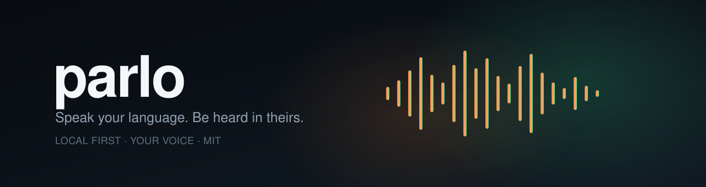
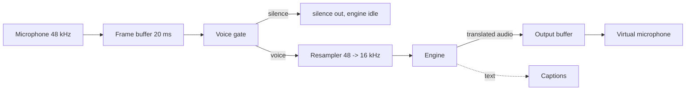

<p align="center">
  
</p>

<p align="center">
  <b>Speak your language. Be heard in theirs. Private, offline, on the PC you already have.</b>
</p>

<p align="center">
  <a href="LICENSE"></a>
  
  
  
  <a href="ROADMAP.md"></a>
</p>

> **Status: v0.1 Spark prototype.** The CPU cascade translates between Portuguese and English end to end, offline. Recognition is NVIDIA Parakeet TDT 0.6B v3 through sherpa-onnx (CC-BY-4.0 model, Apache-2.0 runtime, European Portuguese included), translation is Argos (MIT), and the neutral voice is Piper. Piper is GPL-3.0-or-later: it is installed and run as a separate program, never bundled, and `parlo engines` says so. Measured at **0.11 real time factor on 4 threads** with a 2.5 second window, well inside a conversation. Voice cloning, the desktop app, and automatic hardware selection do not exist yet, and the cascade is selected by hand with `--engine cascade`.

Version numbers follow the milestones in [ROADMAP.md](ROADMAP.md): **v0.1.0** is the first tagged release and its notes are in [docs/releases/v0.1.0.md](docs/releases/v0.1.0.md).

---

## Why another translator

Native translation already exists inside Google Meet, Teams, and Zoom. Parlo is for everything else, and for people who will not send their voice to a cloud:

| | Native translation | Parlo |
|---|---|---|
| Where it works | Only inside its own app | Any app that lets you pick a microphone |
| Does the audio leave your PC | Yes | **No, in local mode** |
| Cost | Bundled in paid plans | **Free** |
| Does the other side need an account | Usually yes | **No** |
| Hardware | Their servers | Your PC, with an honest profile |
| Languages | Many | Few at first, grown by the community |

Parlo also runs where a GPU is a luxury: a desktop without an NVIDIA card is the reference machine, not an afterthought.

## What exists today

| Component | State |
|---|---|
| Streaming pipeline: 20 ms frames, voice gate, resampler, engine boundary | Working, 25 tests |
| CLI: `doctor`, `demo`, `translate`, `engines`, `profile`, `mic`, `record`, `listen` | Working |
| Engine registry with licenses, voice levels, and hardware profiles | Working |
| Virtual microphone via PipeWire (`parlo mic setup`) | Working on Linux |
| Sidecar protocol (JSON lines over stdio) and Rust client | Working, tested |
| Universal cascade: Portuguese and English, both directions, offline, on CPU | Working; RTF 0.11 on 4 threads with Parakeet v3 |
| Hibiki-Zero premium engine | Optional, not wired |
| Desktop app | Not started |

## Try it in 20 seconds

Requires Rust 1.83 or newer. No other dependency.

### The app

```bash
cargo run --release -p parlo-cli -- app
```

The command serves Parlo's interface from the binary itself and opens it in your browser: hold or click the main control to speak, the input level shows the microphone, and the translated voice plays back on the same screen. Nothing is installed and the audio never leaves the machine; when a newer release exists, the screen offers it with its notes linked. Guide: [docs/APP.md](docs/APP.md).

Everything below is also available on the command line.

```bash
cargo run --release -p parlo-cli -- doctor
cargo run --release -p parlo-cli -- profile
cargo run --release -p parlo-cli -- engines
cargo run --release -p parlo-cli -- demo out/demo.wav
cargo run --release -p parlo-cli -- translate out/demo.wav out/translated.wav
```

`profile` turns your machine into an honest recommendation instead of a promise:

```text
hardware profile
  cpu cores       16
  profile         high
  voice level     2 approximate voice
  latency target  2500 to 4000 ms
  note            gpu and memory are not inspected yet, this is a cpu hint
```

`engines` is the licence table the product is built on:

```text
engines
  cascade  available MIT + GPL-3.0 + CC-BY any recent CPU           cpu ok   GPL TTS, CC-BY model
           Universal cascade | 0 captions, 1 neutral voice, 2 approximate voice, 3 cloned voice
  echo     available MIT                   any                      cpu ok   commercial use ok
           Echo for development | 1 neutral voice
  hibiki   planned   CC BY-NC-SA 4.0       NVIDIA 8 to 12 GB VRAM   gpu      non commercial
           Hibiki-Zero premium | 4 end to end transfer
  cloud    planned   vendor terms          any                      cpu ok   check vendor terms
           Cloud with your key | 4 end to end transfer

default engine: cascade (MIT)
```

### Record your own voice and compare recognisers

```bash
cargo run --release -p parlo-cli -- record --list
cargo run --release -p parlo-cli -- record out/voice-01.wav --seconds 6
python engines/cascade/scripts/compare.py out/voice --recognisers parakeet whisper --threads 4
```

Ten short recordings are enough to compare Parakeet and Whisper on your own microphone, which is the only honest way to measure this.

The local API is one command and binds only to loopback:

```bash
cargo run --release -p parlo-cli -- serve --port 8787 --token secret
curl http://127.0.0.1:8787/health
curl -s -H "Authorization: Bearer secret" --data-binary @out/16k.wav \
  http://127.0.0.1:8787/translate --output out/translated.wav
```

It accepts 16 kHz mono PCM16 WAV and returns the same format, so a desktop app can talk to it without linking the models.

On Windows, double-click `TESTAR-VOZ.cmd` in the repository root: it records ten clips with prompts, prints the measured level and the gain applied to each one, compares Parakeet and Whisper on them, runs the live test, and writes `out/voice/report.txt`.

To translate live, without writing a file first:

```bash
cargo run --release -p parlo-cli -- listen out/live.wav --seconds 10
```

`listen` prints how long it ran, how many frames passed the voice gate, and **how many seconds after start the first translated audio was ready**. Playback is still the virtual microphone's job; this writes a file. The pipeline applies the same automatic gain after the voice gate, up to +24 dB, so a quiet microphone still reaches the engine. The gate opens at -55 dBFS, below the -39.7 to -46.2 dBFS that measured laptop speech occupies in 100 ms windows and above a room floor of -63.9 to -67.0 dBFS.

`record` prints the peak level in dBFS and the gain it applied: each file is peak-normalised towards -1 dBFS, boosted by at most +24 dB and never attenuated. That is the same idea as the automatic gain control in a chat app, and the reason a laptop microphone sounds loud in Discord and quiet here: the operating system hands over the raw signal, so the recorder is where the difference is made up. It still warns when the microphone captured almost nothing, which is almost always a muted input, the wrong device, or a Windows privacy setting rather than a code problem.

Building the recorder on Linux needs the ALSA headers: `sudo apt install libasound2-dev pkg-config`. With no microphone attached, `record --list` prints nothing and `record` says so instead of writing a silent file.

### Run the real translator

The CPU cascade is installed with two commands and runs offline afterwards:

```bash
python -m venv .venv
.venv/bin/python -m pip install -r engines/cascade/requirements.txt
.venv/bin/python engines/cascade/scripts/setup_models.py
PARLO_PYTHON=.venv/bin/python cargo run --release -p parlo-cli -- translate in.wav out.wav --engine cascade
```

On Windows use `.venv/Scripts/python`. Installation details and limits: [engines/cascade/README.md](engines/cascade/README.md).

The numbers below are the whole cascade, translation and synthesis included, on ten 6 second clips recorded with a laptop Realtek microphone on Windows 11 with 4 threads. Other Whisper sizes (`small`, `medium`, `large-v3`) are selected with `PARLO_CASCADE_MODEL` and documented in [docs/ENGINES.md](docs/ENGINES.md).

| Recogniser | Download | Measured mean RTF on ten 6 s clips |
|---|---|---|
| **Parakeet TDT 0.6B v3 int8** (default) | 640 MB | **0.45** |
| Whisper base int8 | 145 MB | 1.27 |

## Engine strategy

One product, several engines, one quality ladder. The default must stay usable for anyone, forever:

| Engine | Mode | Hardware | License | Role |
|---|---|---|---|---|
| A. Universal cascade | Voice, captions | Any modern CPU, GPU optional | Permissive only | **Default** |
| B. Captions | Text overlay | Any CPU | Permissive only | Weak hardware |
| C. Hibiki-Zero | Voice preserved | NVIDIA 8 to 12 GB VRAM | CC BY-NC-SA 4.0 | Optional premium |
| D. Cloud with your key | Voice | Any | Vendor terms | Opt-in, off by default |

**Hibiki-Zero is non-commercial.** Its weights are CC BY-NC-SA 4.0, which is why it is a downloadable option with a visible licence warning, never the default engine and never inside the installer. The default path uses only permissively licensed components and `parlo engines` prints that policy.

## Hardware profiles

Design targets, measured before publishing, never promised in advance:

| Profile | Reference hardware | Mode | Latency target |
|---|---|---|---|
| Ultra | NVIDIA 12 GB or recent Apple Silicon | Cascade level 3, or Hibiki | 2 to 3 s |
| High | Any GPU with 6 GB or Apple Silicon | Cascade level 2 to 3 | 2.5 to 4 s |
| Medium | 8+ core CPU, no useful GPU | Cascade level 1 to 2 | 3 to 5 s |
| Basic | Older 4 core CPU | Captions, or light neutral voice | Captions under 2 s |

## How it works



The engine is a trait, not a hard-coded model:

```rust
pub trait Engine: Send {
    fn id(&self) -> &str;
    fn target_languages(&self) -> Vec<String>;
    fn latency_ms(&self) -> u32;
    fn process(&mut self, input: &Frame) -> Result<EngineOutput, EngineError>;
}
```

Adapters talk to the app over a newline-delimited JSON protocol, so a model crash cannot take Parlo down and an engine can ship without a new release. See [docs/ENGINES.md](docs/ENGINES.md) and [docs/ARCHITECTURE.md](docs/ARCHITECTURE.md).

## Privacy

- No network calls in local mode. No telemetry, no accounts, no crash reporting.
- The core crate has zero dependencies; `cargo tree -p parlo-core` is one line.
- Audio is never written to disk unless you pass an output path.
- The app says so when system audio capture is active, and never records silently.

How to verify all of it yourself: [docs/PRIVACY.md](docs/PRIVACY.md).

## Repository layout

```text
crates/parlo-core       audio format, resampler, ring buffer, voice gate, pipeline, wav
crates/parlo-cli        the parlo binary, engine registry, sidecar client, mic commands
engines/hibiki          reference sidecar adapter and protocol tests
docs                    architecture, engines, languages, privacy, troubleshooting
```

## Build and test

```bash
cargo fmt --all --check
cargo clippy --workspace --all-targets -- -D warnings
cargo test --workspace

cd engines/hibiki && python -m unittest discover -s tests
```

CI runs the same commands on Linux, macOS, and Windows.

## Roadmap

v0.1 Spark is this prototype. Next is v0.2 Foundation (stable engine service and reproducible benchmark), then v0.3 Engines (cascade and captions switchable, medium profile measured), then v0.4 Dub, the first public preview that needs no driver and no NVIDIA card.

Exit criteria for every step: [ROADMAP.md](ROADMAP.md).

## Contributing

Issues and pull requests are welcome. Start with [CONTRIBUTING.md](CONTRIBUTING.md); hardware reports and translated READMEs are genuinely useful right now. Look for `good first issue`.

## Credits

The speech-to-speech approach builds on [Hibiki-Zero](https://github.com/kyutai-labs/hibiki) by Kyutai, used as an optional premium engine under its own licence. Parlo is independent and not affiliated with Kyutai.

## License

MIT for the code. Model weights keep their own licenses, listed by `parlo engines`. See [LICENSE](LICENSE).
