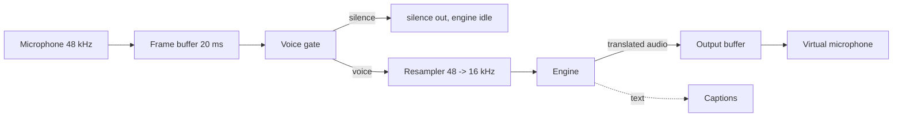

<p align="center">
  
</p>

<p align="center">
  <b>Speak your language. Be heard in theirs. Private, offline, on the PC you already have.</b>
</p>

<p align="center">
  <a href="LICENSE"></a>
  
  
  
  <a href="ROADMAP.md"></a>
</p>

> **Status: v0.1 Spark prototype.** The audio pipeline, latency budget, engine boundary, virtual microphone commands, and CLI are working and tested. **Speech models are not integrated yet**, so `parlo` runs an echo engine and does not translate anything today. The repository is structured so the universal cascade can land without touching the core.

---

## Why another translator

Native translation already exists inside Google Meet, Teams, and Zoom. Parlo is for everything else, and for people who will not send their voice to a cloud:

| | Native translation | Parlo |
|---|---|---|
| Where it works | Only inside its own app | Any app that lets you pick a microphone |
| Does the audio leave your PC | Yes | **No, in local mode** |
| Cost | Bundled in paid plans | **Free** |
| Does the other side need an account | Usually yes | **No** |
| Hardware | Their servers | Your PC, with an honest profile |
| Languages | Many | Few at first, grown by the community |

Parlo also runs where a GPU is a luxury: a desktop without an NVIDIA card is the reference machine, not an afterthought.

## What exists today

| Component | State |
|---|---|
| Streaming pipeline: 20 ms frames, voice gate, resampler, engine boundary | Working, 25 tests |
| CLI: `doctor`, `demo`, `translate`, `engines`, `profile`, `mic` | Working |
| Engine registry with licenses, voice levels, and hardware profiles | Working |
| Virtual microphone via PipeWire (`parlo mic setup`) | Working on Linux |
| Sidecar protocol (JSON lines over stdio) and Rust client | Working, tested |
| Universal cascade (speech to text, translation, text to speech) | Not implemented |
| Hibiki-Zero premium engine | Optional, not wired |
| Desktop app | Not started |

## Try it in 20 seconds

Requires Rust 1.83 or newer. No other dependency.

```bash
cargo run --release -p parlo-cli -- doctor
cargo run --release -p parlo-cli -- profile
cargo run --release -p parlo-cli -- engines
cargo run --release -p parlo-cli -- demo out/demo.wav
cargo run --release -p parlo-cli -- translate out/demo.wav out/translated.wav
```

`profile` turns your machine into an honest recommendation instead of a promise:

```text
hardware profile
  cpu cores       16
  profile         high
  voice level     2 approximate voice
  latency target  2500 to 4000 ms
  note            gpu and memory are not inspected yet, this is a cpu hint
```

`engines` is the licence table the product is built on:

```text
engines
  cascade  planned   MIT              any recent CPU           commercial use ok
           Universal cascade | 0 captions, 1 neutral voice, 2 approximate voice
  echo     available MIT              any                      commercial use ok
           Echo for development | 1 neutral voice
  hibiki   planned   CC BY-NC-SA 4.0  NVIDIA 8 to 12 GB VRAM   non commercial
           Hibiki-Zero premium | 4 end to end transfer
```

## Engine strategy

One product, several engines, one quality ladder. The default must stay usable for anyone, forever:

| Engine | Mode | Hardware | License | Role |
|---|---|---|---|---|
| A. Universal cascade | Voice, captions | Any modern CPU, GPU optional | Permissive only | **Default** |
| B. Captions | Text overlay | Any CPU | Permissive only | Weak hardware |
| C. Hibiki-Zero | Voice preserved | NVIDIA 8 to 12 GB VRAM | CC BY-NC-SA 4.0 | Optional premium |
| D. Cloud with your key | Voice | Any | Vendor terms | Opt-in, off by default |

**Hibiki-Zero is non-commercial.** Its weights are CC BY-NC-SA 4.0, which is why it is a downloadable option with a visible licence warning, never the default engine and never inside the installer. The default path uses only permissively licensed components and `parlo engines` prints that policy.

## Hardware profiles

Design targets, measured before publishing, never promised in advance:

| Profile | Reference hardware | Mode | Latency target |
|---|---|---|---|
| Ultra | NVIDIA 12 GB or recent Apple Silicon | Cascade level 3, or Hibiki | 2 to 3 s |
| High | Any GPU with 6 GB or Apple Silicon | Cascade level 2 to 3 | 2.5 to 4 s |
| Medium | 8+ core CPU, no useful GPU | Cascade level 1 to 2 | 3 to 5 s |
| Basic | Older 4 core CPU | Captions, or light neutral voice | Captions under 2 s |

## How it works



The engine is a trait, not a hard-coded model:

```rust
pub trait Engine: Send {
    fn id(&self) -> &str;
    fn target_languages(&self) -> Vec<String>;
    fn latency_ms(&self) -> u32;
    fn process(&mut self, input: &Frame) -> Result<EngineOutput, EngineError>;
}
```

Adapters talk to the app over a newline-delimited JSON protocol, so a model crash cannot take Parlo down and an engine can ship without a new release. See [docs/ENGINES.md](docs/ENGINES.md) and [docs/ARCHITECTURE.md](docs/ARCHITECTURE.md).

## Privacy

- No network calls in local mode. No telemetry, no accounts, no crash reporting.
- The core crate has zero dependencies; `cargo tree -p parlo-core` is one line.
- Audio is never written to disk unless you pass an output path.
- The app says so when system audio capture is active, and never records silently.

How to verify all of it yourself: [docs/PRIVACY.md](docs/PRIVACY.md).

## Repository layout

```text
crates/parlo-core       audio format, resampler, ring buffer, voice gate, pipeline, wav
crates/parlo-cli        the parlo binary, engine registry, sidecar client, mic commands
engines/hibiki          reference sidecar adapter and protocol tests
docs                    architecture, engines, languages, privacy, troubleshooting
```

## Build and test

```bash
cargo fmt --all --check
cargo clippy --workspace --all-targets -- -D warnings
cargo test --workspace

cd engines/hibiki && python -m unittest discover -s tests
```

CI runs the same commands on Linux, macOS, and Windows.

## Roadmap

v0.1 Spark is this prototype. Next is v0.2 Foundation (stable engine service and reproducible benchmark), then v0.3 Engines (cascade and captions switchable, medium profile measured), then v0.4 Dub, the first public preview that needs no driver and no NVIDIA card.

Exit criteria for every step: [ROADMAP.md](ROADMAP.md).

## Contributing

Issues and pull requests are welcome. Start with [CONTRIBUTING.md](CONTRIBUTING.md); hardware reports and translated READMEs are genuinely useful right now. Look for `good first issue`.

## Credits

The speech-to-speech approach builds on [Hibiki-Zero](https://github.com/kyutai-labs/hibiki) by Kyutai, used as an optional premium engine under its own licence. Parlo is independent and not affiliated with Kyutai.

## License

MIT for the code. Model weights keep their own licenses, listed by `parlo engines`. See [LICENSE](LICENSE).
