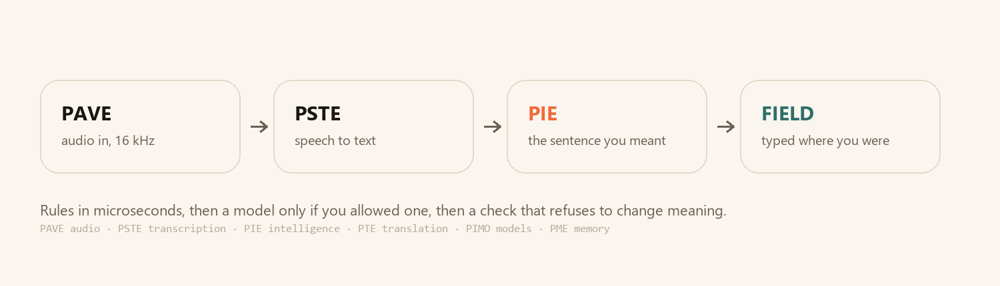
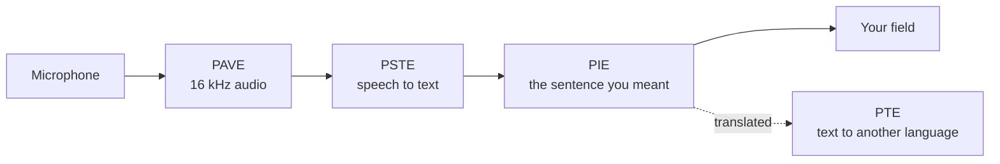

<p align="center">
  
</p>

<p align="center">
  <b>Dictation and translation that run on your own computer.</b><br>
  Nothing is uploaded. There is no account, no telemetry and no subscription.
</p>

<p align="center">
  <a href="https://github.com/PedroNascimento09/Parlo/actions/workflows/ci.yml"></a>
  
  
  
  
  
</p>

Parlo listens to you speak, writes down the sentence you meant instead of every word you said, and translates it when you want the other language. It runs on an ordinary laptop CPU, keeps every model on your disk, and only touches the network to check for a new version — or to reach a cloud provider **you** configured with **your** key.

```
Ctrl+Alt+D → speak → «Quero marcar para sexta, quer dizer, segunda.» → written as:
Vou ao Porto na segunda-feira.
```

## What you can do today

| | |
|---|---|
| **Dictate anywhere** | `Ctrl+Alt+D` opens the island and starts listening. The text is typed into the field you came from, or copied when the window changed. |
| **The sentence you meant** | Self-corrections, hesitations, false starts and accidental repetitions are fixed on rules alone: **61.9 µs** per sentence, no model, no network. The sentence as heard is kept beside it. |
| **Cleanup your way** | *Rules only*, *a model on this machine*, *your cloud provider*, or *Automatic*. Cloud is never reached without an explicit switch and a stored key. |
| **Your key, your vault** | OpenAI, Anthropic, Gemini and any OpenAI-compatible server. Keys live in DPAPI, the macOS keychain or the Linux secret service — never in a config file, a log or an error message. |
| **Words Parlo should know** | Your names and short forms, applied before any model reads the sentence, kept in a local file. |
| **Translate and speak** | Portuguese ↔ English, offline, with a neutral voice; dubbing a video with subtitles works too. |
| **Meetings** | Import a transcript with speakers, or record the microphone into one, line by line, with timestamps. |
| **Free when idle** | Loaded models are released after 10 minutes to 4 hours of silence, or never, your choice. |

## Install

**From a release — no Python, no Rust.** Download the archive for your system, unpack it, double-click `parlo-app`, let it download about 800 MB of models once, and you are offline for good.

```text
parlo-windows-x86_64.zip     parlo-macos-aarch64.tar.gz     parlo-linux-x86_64.tar.gz
```

**From source** — Rust 1.85 or newer.

```bash
cargo build --release -p parlo-cli -p parlo-app
target/release/parlo-app
```

`parlo install` copies it into your user folder with a menu entry; `parlo update` replaces the running copy in place, and the window offers each new release with its notes and an **Install update** button. No version is ever installed by uninstalling the old one.

## See it

<p align="center">
  <br>
  <sub>The dictation island, after a correction was resolved and the text was typed where you were.</sub>
</p>

<p align="center">
  <br>
  <sub>One path, one responsibility per engine. The names are defined in <a href="PARLO_GLOSSARY.md">PARLO_GLOSSARY.md</a>.</sub>
</p>

## Measured

Windows 11 laptop, no GPU, 4 threads, warm process. Conditions and raw rows in [docs/BENCHMARKS.md](docs/BENCHMARKS.md); nothing here is a claim about a machine nobody ran it on.

| What | Result |
|---|---|
| Cleanup rules, 10 sentences × 1 000 runs | **61.9 µs** mean, 102.1 µs p95 |
| One segment through the cascade, recognition included | **420.7 ms** mean, 485 ms p95 |
| Thirty minutes of audio, 1 095 segments | no drift, no errors; last ten cycles 58 ms faster than the first |
| Streaming, European Portuguese | first partial **849 ms**, final text **3 356 ms**, WER **0.231** |
| Real time factor, Parakeet v3 int8 on 4 threads | **0.11** |
| Cold start with every model | **18.1 s** |

Not measured, and not claimed: any cloud provider's latency or price. No live request has been made to one with a real key.

## How it differs

| | Native call translation | Parlo |
|---|---|---|
| Works in | Only that app | Any field, any app that takes keyboard input |
| Audio leaves the PC | Yes | **No in local mode** |
| Cost | Paid plan | **Free**, your hardware |
| The other side needs an account | Usually | **No** |
| Cloud AI | Required | Optional, your key, off by default |
| Languages | Many | Portuguese and English today, honestly labelled |

## How it works



An engine is chosen by responsibility, not by vendor: **PAVE** owns audio, **PSTE** recognition, **PIE** the text, **PTE** translation, **PIMO** which model runs and when it leaves memory, **PME** what is remembered. The backend is a Python sidecar behind a newline-delimited JSON protocol, so a model crash cannot take the window down; the app is Rust with a Tauri shell. [docs/ARCHITECTURE.md](docs/ARCHITECTURE.md) has the detail.

## Privacy

- Local mode makes no network call. No telemetry, no accounts, no crash reporting.
- Audio is never written to disk unless you pass an output path.
- A cloud provider is reached only when you allow it, store a key and pick it, over HTTPS or loopback, straight from your machine — there is no Parlo server in the middle.
- Your vocabulary, history and meetings stay in your user data folder, and every one of them can be deleted from the interface.

How to verify it yourself: [docs/PRIVACY.md](docs/PRIVACY.md).

## Build and test

```bash
cargo fmt --all --check
cargo clippy --workspace --all-targets -- -D warnings
cargo test --workspace

cd engines/cascade && PYTHONPATH=. python -m unittest discover -s tests
```

CI runs those on Linux, macOS and Windows, plus the licence gate that keeps every artefact's terms in [LICENSES.md](LICENSES.md).

## Roadmap

The next release is **v0.2.0**: cloud cost control, per-model unload rules in the interface, and Ask Parlo over past meetings. After that, **v0.3 Ouir** decides with data before adding features, and the plan stops at **v0.5 Escrever noutra língua** — spoken Portuguese written as English, German, Spanish or French in the active field. Milestones in [ROADMAP.md](ROADMAP.md) are labels; releases come from [docs/releases](docs/releases) and are announced inside the app.

## Docs

[App guide](docs/APP.md) · [Architecture](docs/ARCHITECTURE.md) · [Engines](docs/ENGINES.md) · [Benchmarks](docs/BENCHMARKS.md) · [Intelligence engine](docs/INTELLIGENCE.md) · [Glossary](PARLO_GLOSSARY.md) · [Privacy](docs/PRIVACY.md) · [Troubleshooting](docs/TROUBLESHOOTING.md) · [Licences](docs/LICENSES.md)

## Contributing

Issues and pull requests are welcome — [CONTRIBUTING.md](CONTRIBUTING.md) starts with the three smallest useful things: a hardware report from your own machine, a recording in your accent, or a translation of this page. `good first issue` is where to look first.

## Licence

The code is **Apache-2.0**: commercial use, modification and redistribution allowed, with a patent grant. Model weights keep their publishers' terms — Parakeet is CC-BY-4.0, the OPUS-MT packages are CC BY 4.0 — and the optional Piper adapter is GPL-3.0-or-later, installed separately and never in an archive. [LICENSES.md](LICENSES.md) is the index, [THIRD_PARTY_NOTICES.md](THIRD_PARTY_NOTICES.md) carries the notices, and [docs/LICENSES.md](docs/LICENSES.md) explains the split.

<p align="center"><sub>Parlo is an independent project. The speech-to-speech approach builds on <a href="https://github.com/kyutai-labs/hibiki">Hibiki-Zero</a> by Kyutai, used as an optional engine under its own licence.</sub></p>
