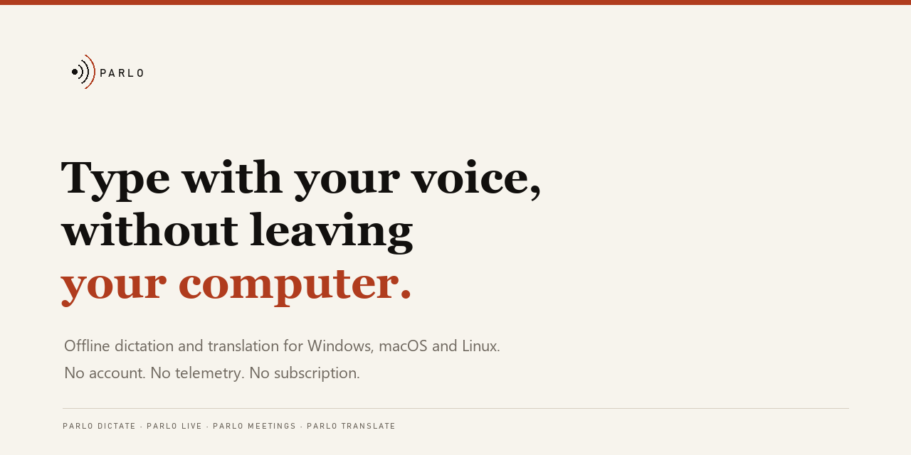

<p align="center">
  
</p>

<p align="center">
  <b>Speech in. Text out. In any app, in two languages, on your own computer.</b><br>
  Dictation, live text, captions, meetings and dubbing share one engine.<br>
  Windows, macOS and Linux. No account, no telemetry, no audio upload.
</p>

<p align="center">
  <a href="https://github.com/PedroNascimento09/Parlo/releases/latest"></a>
  <a href="https://github.com/PedroNascimento09/Parlo/actions/workflows/ci.yml"></a>
  <a href="LICENSE"></a>
  <a href="https://github.com/PedroNascimento09/Parlo/stargazers"></a>
</p>

<p align="center">
  
</p>

Parlo is a desktop app that turns speech into writing without sending it anywhere. Press a shortcut, speak, and the sentence appears in the field you were already typing in, cleaned up, translated if you asked for another language. The same engine powers live text, captions, meetings and dubbing, so a model installed once serves every surface.

## Four surfaces, one engine

- **Dictate.** One shortcut from anywhere. The text is typed into the window that had the focus, and that window keeps its cursor. Escape throws the sentence away.
- **Live.** Text while you speak, with the translation in a second column, in windows of about 2.5 seconds. It starts when the window opens and stops on Escape.
- **Captions.** A floating strip for a call or a video, translated as it goes, with one button that changes the size. Escape stops the microphone.
- **Meetings.** Record the room or import a transcript. Every line keeps its time and its speaker, speakers can be renamed, the whole transcript is searchable and copies out as Markdown.
- **Translate a file.** Drop a recording and get it back dubbed, with subtitles timed to the source beside it.

## What is inside

| | |
|---|---|
| **A model manager that tells the truth** | One row per model: size on disk, `Installed · unloaded`, `Loaded` or `In use`, a measured quality number or an honest "no number measured", a delay before it is freed, and `Load`, `Unload now` and `Remove` as separate actions. |
| **Two recognisers, chosen per machine** | Parakeet TDT 0.6B v3 int8 is the default; Whisper `tiny` to `large-v3` stays selectable where 640 MB is too much. |
| **Translation with a gate** | Portuguese and English, both directions. 100 original sentences are checked for numbers, clocks, negations, names and completeness before a release is called good. |
| **Words Parlo should learn** | A local vocabulary fixes the names the recogniser keeps missing, on whole words only, before any model reads the sentence. |
| **A history you can use again** | Every dictation keeps what was said, what was written and the program it landed in, and one click puts a line back on the clipboard. |
| **Updates inside the app** | The latest release arrives with its notes and one button, and replaces the running copy instead of asking you to uninstall. |

## Install

**Windows.** [Download Parlo-Setup.exe](https://github.com/PedroNascimento09/Parlo/releases/latest/download/Parlo-Setup.exe) and double click it. It installs for your user, adds a Start menu entry and opens Parlo when it finishes, so one download is the whole install. The build is unsigned, so SmartScreen asks once: **More info**, then **Run anyway**.

**macOS and Linux**, in any terminal:

```bash
curl -fsSL https://raw.githubusercontent.com/PedroNascimento09/Parlo/main/scripts/install.sh | bash
```

**From source**, with Rust 1.85 or newer and Python 3.12 for the engine:

```bash
cargo build --release -p parlo-cli -p parlo-app
target/release/parlo-app
```

The installer is 44.8 MB. On first start the model list offers the recogniser alone, about 640 MB, and nothing else downloads until you press its button. Translation, read aloud and captions are separate switches, and each names the model and its size before anything moves. After that the machine can stay offline.

## Measured

Windows 11 laptop, no GPU, 4 threads. Conditions and every raw row are in [docs/BENCHMARKS.md](docs/BENCHMARKS.md).

| What | Result |
|---|---|
| Cleanup rules, 10 sentences × 1 000 runs | **61.9 µs** mean |
| One segment through the cascade, recognition included | **420.7 ms** mean, 485 ms p95 |
| Real time factor, Parakeet v3 int8 | **0.11** |
| Captions, speech to screen at a 1.2 s window | **about 1.6 s** |
| Streaming, first partial to finished sentence | **849 ms** to **3 355 ms** |

Nothing here describes a machine nobody ran, and no provider latency or price is claimed: no request to a cloud provider has been made with a real key.

## Privacy

Local mode makes no network call. Audio is never written to disk unless you pass an output path. A provider is reached only when you allow it, store your own key and pick it, over HTTPS or loopback, straight from your machine. History, meetings and vocabulary stay in your user data folder and each can be deleted from the interface. [docs/PRIVACY.md](docs/PRIVACY.md) shows how to check.

## What is not there yet

- The dictation shortcut is Windows only. On macOS and Linux the text goes to the clipboard.
- Portuguese to German runs through English and is published as **not validated by a native speaker**.
- Dictation is tested, not yet validated with recordings from people other than the author.
- The build is unsigned, and there is no signed `.msi`, `.dmg` or `.deb`.
- Meetings record the microphone rather than the sound of another application, there is no meeting summary yet, and speakers are labelled by the recogniser rather than separated by a model trained for it.
- Read aloud uses a neutral European Portuguese voice that no panel of listeners has judged, and no voice is cloned from a recording.

## Docs

[App guide](docs/APP.md) · [Interface](docs/UX.md) · [Architecture](docs/ARCHITECTURE.md) · [Engines](docs/ENGINES.md) · [Models](docs/MODEL_MANAGER.md) · [Benchmarks](docs/BENCHMARKS.md) · [Install](docs/INSTALL.md) · [Privacy](docs/PRIVACY.md) · [Troubleshooting](docs/TROUBLESHOOTING.md) · [Changelog](CHANGELOG.md) · [Contributing](CONTRIBUTING.md)

## Licence

The code is **Apache-2.0**. Model weights keep their publishers' terms: Parakeet is CC-BY-4.0, the OPUS-MT packages are CC BY 4.0, and the optional Piper adapter is GPL-3.0-or-later, installed separately and never shipped in an archive. [LICENSES.md](LICENSES.md) is the index and [THIRD_PARTY_NOTICES.md](THIRD_PARTY_NOTICES.md) carries the notices.
