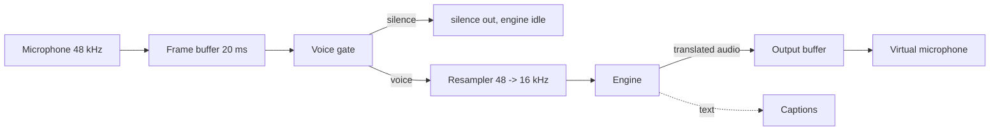

<p align="center">
  
</p>

<p align="center">
  <b>Speak your language. Be heard in theirs. Private, offline, on the PC you already have.</b>
</p>

<p align="center">
  <a href="LICENSE"></a>
  
  
  
  <a href="ROADMAP.md"></a>
</p>

> **Status: v0.1.7, early prototype.** The CPU cascade translates between Portuguese and English end to end, offline. Recognition is NVIDIA Parakeet TDT 0.6B v3 through sherpa-onnx (CC-BY-4.0 model, Apache-2.0 runtime, European Portuguese included), translation is Argos (MIT), and the neutral voice is Piper, GPL-3.0-or-later, installed separately as an optional adapter and never shipped in a release archive, so the engine program itself stays permissive; [docs/LICENSES.md](docs/LICENSES.md) explains the split and `parlo engines` prints the table. Measured at **0.11 real time factor on 4 threads** with a 2.5 second window, well inside a conversation. The interface opens in its own window (`parlo-app`, a thin native shell around the page the binary serves on loopback), a voice profile can be created in the app with its consent recorded locally and deleted on request, but the sample that would make cloning work is not recorded yet, and there is no virtual microphone. The cascade is chosen with `--engine cascade` on the command line or is the default in the app.

**Where this is going.** The objective is Parlo Live: two people talking in their own languages, each hearing the other translated, in the speaker's own voice, inside the call application they already use. Translated captions, dubbing and the neutral voice are the steps that exist today, and none of them replaces that objective. See `docs/plan/v12_3/35_parte_vii_ix.md`, sections 66.1 to 66.3, for what it requires and what is still unknown.

Milestones in [ROADMAP.md](ROADMAP.md) are roadmap labels, not version numbers: the version advances one step from the last published tag, so a milestone can close inside any of them. Only tagged releases reach users, **v0.1.0** was the first, and every release publishes its own notes under [docs/releases](docs/releases).

---

## Why another translator

Native translation already exists inside Google Meet, Teams, and Zoom. Parlo is for everything else, and for people who will not send their voice to a cloud:

| | Native translation | Parlo |
|---|---|---|
| Where it works | Only inside its own app | Any app that lets you pick a microphone |
| Does the audio leave your PC | Yes | **No, in local mode** |
| Cost | Bundled in paid plans | **Free** |
| Does the other side need an account | Usually yes | **No** |
| Hardware | Their servers | Your PC, with an honest profile |
| Languages | Many | Few at first, grown by the community |

Parlo also runs where a GPU is a luxury: a desktop without an NVIDIA card is the reference machine, not an afterthought.

## What exists today

| Component | State |
|---|---|
| Streaming pipeline: 20 ms frames, voice gate, resampler, engine boundary | Working, 25 tests |
| CLI: `doctor`, `demo`, `translate`, `stream`, `dub`, `engines`, `profile`, `mic`, `record`, `listen`, `captions`, `speakers` | Working |
| Engine registry with licenses, voice levels, and hardware profiles | Working |
| Virtual microphone via PipeWire (`parlo mic setup`) | Working on Linux |
| Sidecar protocol (JSON lines over stdio) and Rust client | Working, tested |
| Universal cascade: Portuguese and English, both directions, offline, on CPU | Working; RTF 0.11 on 4 threads with Parakeet v3 |
| File dubbing: `parlo dub video.mp4 --to en`, subtitles included | Working, needs ffmpeg |
| Captions mode: `parlo captions`, translated text with no voice | Working, about 2.2 s behind while speaking |
| Playback: `parlo listen --play --speaker N`, or `parlo speakers` to list devices | Working, Windows verified by stream, not by ear yet |
| Self-contained engine: the release archive carries `parlo` and a `parlo-engine` folder | Working, no Python needed |
| Hibiki-Zero premium engine | Optional, not wired |
| App interface | Working: `parlo-app` opens it in a native window, `parlo app` falls back to the browser |

## Try it

### From a release: no Python, no Rust

Download the archive for your system from the latest release, unzip it, and double-click the window program inside:

```text
parlo-app
```

On Windows that is `parlo-app.exe`. The archive holds three things: `parlo-app`, the window; `parlo`, the command line behind it; and a folder named `parlo-engine` holding the offline translation engine and its libraries, about 900 MB once unpacked. Keep the folder next to the programs, because that is where they look for it. The window loads its own engine, shows a starting screen for the roughly eighteen seconds the models take to load, then hands you the interface; the first time, the Models panel downloads what it needs into your user data folder, roughly 800 MB once, and everything works offline afterwards. The first launch therefore needs a network connection once, and `ffmpeg` on `PATH` is needed only for dubbing files. On Windows the window uses WebView2, which comes with Windows 10 and 11; on Linux it uses WebKitGTK.

Models, settings and the downloaded pieces live in `%APPDATA%\parlo` on Windows, `~/Library/Application Support/parlo` on macOS, and `$XDG_DATA_HOME/parlo` (usually `~/.local/share/parlo`) elsewhere. `PARLO_MODELS_DIR` points the models at another folder, and `parlo update` replaces the running copy in place, so no version is ever installed by uninstalling the old one.

Archives published before v0.1.6 contain only `parlo` and need the source checkout below.

To keep it instead of running it from the downloads folder, install it for your user and get a menu entry:

```bash
parlo install
```

That copies `parlo`, `parlo-app` and the `parlo-engine` folder into `%LOCALAPPDATA%\Programs\Parlo` on Windows, `~/Applications/Parlo` on macOS or `~/.local/opt/parlo` on Linux, adds a Start Menu entry on Windows or an application menu entry on Linux that opens the window, and prints the path to it. macOS gets no menu entry yet; open `~/Applications/Parlo/parlo-app` from a terminal or add it to the Dock once. `parlo uninstall` removes the programs and the menu entry and leaves your models alone; add `--purge` to remove those too.

### From a source checkout

Requires Rust 1.85 or newer. No other dependency.

```bash
cargo build --release -p parlo-cli -p parlo-app
target/release/parlo-app
```

That opens the window, which starts the engine itself and looks for `parlo` beside itself, so both programs are built. `cargo run --release -p parlo-cli -- app` is the same interface in a browser, which is what `parlo app` falls back to when `parlo-app` is not beside it. Either way, hold or click the main control to speak, the input level confirms the microphone, the translated sentence appears with the translated voice. Nothing is installed and the audio never leaves the machine; when a tagged release is newer than the running one, a banner offers it with its notes linked and an **Install update** button that installs over the running copy, and `parlo update` does the same from a terminal. The same page carries the language and recogniser settings, a models panel that downloads whatever is missing, and a drop zone that dubs a video or a recording offline; a `Live` toggle keeps it listening, translating one 2.5 second window at a time and speaking each one in order. Those choices are written to the config file, so the next start keeps them. Guide: [docs/APP.md](docs/APP.md).

Everything below is also available on the command line.

```bash
cargo run --release -p parlo-cli -- doctor
cargo run --release -p parlo-cli -- profile
cargo run --release -p parlo-cli -- engines
cargo run --release -p parlo-cli -- demo out/demo.wav
cargo run --release -p parlo-cli -- translate out/demo.wav out/translated.wav
```

`profile` turns your machine into an honest recommendation instead of a promise:

```text
hardware profile
  cpu cores       16
  profile         high
  voice level     2 approximate voice
  latency target  2500 to 4000 ms
  note            gpu and memory are not inspected yet, this is a cpu hint
```

`engines` is the licence table the product is built on:

```text
engines
  cascade  available Apache-2.0, optional GPL voice  any recent CPU  cpu ok   Apache-2.0 engine, GPL voice optional
           Universal cascade | 0 captions, 1 neutral voice, 2 approximate voice, 3 cloned voice
  echo     available MIT                   any                      cpu ok   commercial use ok
           Echo for development | 1 neutral voice
  hibiki   planned   CC BY-NC-SA 4.0       NVIDIA 8 to 12 GB VRAM   gpu      non commercial
           Hibiki-Zero premium | 4 end to end transfer
  cloud    planned   vendor terms          any                      cpu ok   check vendor terms
           Cloud with your key | 4 end to end transfer

default engine: cascade (Apache-2.0)
```

### Record your own voice and compare recognisers

```bash
cargo run --release -p parlo-cli -- record --list
cargo run --release -p parlo-cli -- record out/voice-01.wav --seconds 6
python engines/cascade/scripts/compare.py out/voice --recognisers parakeet whisper --threads 4
```

Ten short recordings are enough to compare Parakeet and Whisper on your own microphone, which is the only honest way to measure this.

The local API is one command and binds only to loopback:

```bash
cargo run --release -p parlo-cli -- serve --port 8787 --token secret
curl http://127.0.0.1:8787/health
curl -s -H "Authorization: Bearer secret" --data-binary @out/16k.wav \
  http://127.0.0.1:8787/translate --output out/translated.wav
```

It accepts 16 kHz mono PCM16 WAV and returns the same format, so a desktop app can talk to it without linking the models.

On Windows, double-click `TESTAR-VOZ.cmd` in the repository root: it records ten clips with prompts, prints the measured level and the gain applied to each one, compares Parakeet and Whisper on them, runs the live test, and writes `out/voice/report.txt`.

To translate live, without writing a file first:

```bash
cargo run --release -p parlo-cli -- listen out/live.wav --seconds 10
```

`listen` prints how long it ran, how many frames passed the voice gate, and **how many seconds after start the first translated audio was ready**.

Add `--play` to hear the translation while you speak, on any output device:

```bash
parlo speakers                                  # list output devices by number
parlo listen out/live.wav --seconds 30 --play --speaker 1
```

The translated voice is rate matched to the device and queued in a bounded buffer, so a slow machine drops the oldest audio instead of falling further behind. On Windows and macOS this is also the interim route into a call app: point `--speaker` at a virtual cable such as VB-Cable and pick that cable as the microphone in Discord, Meet or Teams. The Linux answer is the PipeWire microphone built into `parlo mic`.

The pipeline applies the same automatic gain after the voice gate, up to +24 dB, so a quiet microphone still reaches the engine. The gate opens at -55 dBFS, below the -39.7 to -46.2 dBFS that measured laptop speech occupies in 100 ms windows and above a room floor of -63.9 to -67.0 dBFS.

`record` prints the peak level in dBFS and the gain it applied: each file is peak-normalised towards -1 dBFS, boosted by at most +24 dB and never attenuated. That is the same idea as the automatic gain control in a chat app, and the reason a laptop microphone sounds loud in Discord and quiet here: the operating system hands over the raw signal, so the recorder is where the difference is made up. It still warns when the microphone captured almost nothing, which is almost always a muted input, the wrong device, or a Windows privacy setting rather than a code problem.

Building the recorder on Linux needs the ALSA headers: `sudo apt install libasound2-dev pkg-config`. With no microphone attached, `record --list` prints nothing and `record` says so instead of writing a silent file.

### Run the real translator

The CPU cascade is installed with two commands and runs offline afterwards:

```bash
python -m venv .venv
.venv/bin/python -m pip install -r engines/cascade/requirements.txt
.venv/bin/python engines/cascade/scripts/setup_models.py
PARLO_PYTHON=.venv/bin/python cargo run --release -p parlo-cli -- translate in.wav out.wav --engine cascade
```

On Windows use `.venv/Scripts/python`. Installation details and limits: [engines/cascade/README.md](engines/cascade/README.md).

The numbers below are the whole cascade, translation and synthesis included, on ten 6 second clips recorded with a laptop Realtek microphone on Windows 11 with 4 threads. Other Whisper sizes (`small`, `medium`, `large-v3`) are selected with `PARLO_CASCADE_MODEL` and documented in [docs/ENGINES.md](docs/ENGINES.md).

| Recogniser | Download | Measured mean RTF on ten 6 s clips |
|---|---|---|
| **Parakeet TDT 0.6B v3 int8** (default) | 640 MB | **0.45** |
| Whisper base int8 | 145 MB | 1.27 |

### Dub a video or a recording

With the cascade installed and `ffmpeg` on `PATH`, one command translates a file and writes a new one:

```bash
parlo dub video.mp4 --to en
```

It writes `video.en.mp4` with a new voice track and `video.en.srt` with the translated lines, keeping the video untouched. File mode takes minutes rather than seconds and needs no microphone, driver or NVIDIA card. `--keep-background` leaves music and effects under the dub, and the input can be audio instead of video. Timing, limits and the measured output: [docs/DUB.md](docs/DUB.md).

## Engine strategy

One product, several engines, one quality ladder. The default must stay usable for anyone, forever:

| Engine | Mode | Hardware | License | Role |
|---|---|---|---|---|
| A. Universal cascade | Voice, captions | Any modern CPU, GPU optional | Apache-2.0, voice optional and GPL | **Default** |
| B. Captions | Text overlay | Any CPU | Apache-2.0 | Weak hardware |
| C. Hibiki-Zero | Voice preserved | NVIDIA 8 to 12 GB VRAM | CC BY-NC-SA 4.0 | Optional premium |
| D. Cloud with your key | Voice | Any | Vendor terms | Opt-in, off by default |

**Hibiki-Zero is non-commercial.** Its weights are CC BY-NC-SA 4.0, which is why it is a downloadable option with a visible licence warning, never the default engine and never inside the archive.

**The core is permissive and the voice is optional.** The engine, the CLI, the window and the cascade are Apache-2.0. Piper is GPL-3.0-or-later and lives in `engines/tts-piper`, which is not in any archive and is installed by its own command, so no Parlo download distributes a GPL work. The recogniser weights are CC-BY-4.0 and the Argos translation models are MIT. The full table, and what each licence asks of you, is in [docs/LICENSES.md](docs/LICENSES.md).

## Hardware profiles

Design targets, measured before publishing, never promised in advance:

| Profile | Reference hardware | Mode | Latency target |
|---|---|---|---|
| Ultra | NVIDIA 12 GB or recent Apple Silicon | Cascade level 3, or Hibiki | 2 to 3 s |
| High | Any GPU with 6 GB or Apple Silicon | Cascade level 2 to 3 | 2.5 to 4 s |
| Medium | 8+ core CPU, no useful GPU | Cascade level 1 to 2 | 3 to 5 s |
| Basic | Older 4 core CPU | Captions, or light neutral voice | Captions under 2 s |

## How it works



The engine is a trait, not a hard-coded model:

```rust
pub trait Engine: Send {
    fn id(&self) -> &str;
    fn target_languages(&self) -> Vec<String>;
    fn latency_ms(&self) -> u32;
    fn process(&mut self, input: &Frame) -> Result<EngineOutput, EngineError>;
}
```

Adapters talk to the app over a newline-delimited JSON protocol, so a model crash cannot take Parlo down and an engine can ship without a new release. See [docs/ENGINES.md](docs/ENGINES.md) and [docs/ARCHITECTURE.md](docs/ARCHITECTURE.md).

## Privacy

- No network calls in local mode. No telemetry, no accounts, no crash reporting.
- The core crate has zero dependencies; `cargo tree -p parlo-core` is one line.
- Audio is never written to disk unless you pass an output path.
- The app says so when system audio capture is active, and never records silently.

How to verify all of it yourself: [docs/PRIVACY.md](docs/PRIVACY.md).

## Repository layout

```text
crates/parlo-core       audio format, resampler, ring buffer, voice gate, pipeline, wav
crates/parlo-cli        the parlo binary, engine registry, sidecar client, mic and dub commands
engines/hibiki          reference sidecar adapter and protocol tests
engines/tts-piper       optional Piper synthesiser adapter, GPL-3.0-or-later
catalog                 model catalogue with the licence of every artefact
tools                   licence gate, third party notices and SBOM generator
docs                    architecture, engines, languages, privacy, troubleshooting
```

## Build and test

```bash
cargo fmt --all --check
cargo clippy --workspace --all-targets -- -D warnings
cargo test --workspace

cd engines/hibiki && python -m unittest discover -s tests
```

CI runs the same commands on Linux, macOS, and Windows.

## Roadmap

v0.2 Foundation is done: the pipeline, the token bearing local API and the reproducible benchmark exist, and thirty minutes of audio ran at 420.7 ms mean with no drift. The plan's next milestone is **v0.3 Ouvir**, which adds no feature and decides with data: streaming recognition that publishes partial, stable and final text, measured against the reference tools before the interface grows. What the plan commits to stops at **v0.5**: **v0.4 Ditar** puts dictation in any application, and **v0.5 Escrever noutra língua** turns spoken Portuguese into written English, German, Spanish or French in the active field, with Portuguese to German as the quality gate. Dubbing, the native window, captions and the model panel already work and are measured, ahead of where the plan schedules them.

Exit criteria for every step: [ROADMAP.md](ROADMAP.md).

## Contributing

Issues and pull requests are welcome. Start with [CONTRIBUTING.md](CONTRIBUTING.md); hardware reports and translated READMEs are genuinely useful right now. Look for `good first issue`.

## Credits

The speech-to-speech approach builds on [Hibiki-Zero](https://github.com/kyutai-labs/hibiki) by Kyutai, used as an optional premium engine under its own licence. Parlo is independent and not affiliated with Kyutai.

## Licensing

Parlo is open source. The original code, the three Rust crates, the page, the cascade engine, the tools and the scripts, is **Apache-2.0**, which allows commercial use, modification, redistribution and use inside proprietary products, and adds an express patent grant. See [LICENSE](LICENSE).

Some things have their own licence and are not covered by it: the optional Piper adapter is GPL-3.0-or-later, the packaged engine ships no GPL code, and every model weight or voice keeps the licence of its publisher. **[LICENSES.md](LICENSES.md) is the index** of all of them, section by section, with what each one obliges you to do. Notices and full texts are in [THIRD_PARTY_NOTICES.md](THIRD_PARTY_NOTICES.md) and [`licenses/`](licenses), the reasoning is in [docs/LICENSES.md](docs/LICENSES.md).
