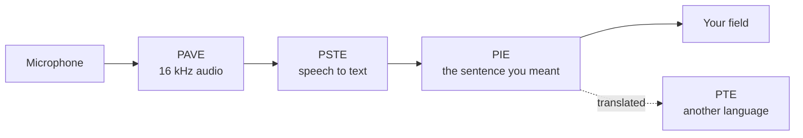

<p align="center">
  
</p>

<p align="center">
  <b>Speak in any app. Get the sentence you meant, in another language, on your own computer.</b><br>
  Windows, macOS and Linux. No account, no telemetry, no audio upload.
</p>

<p align="center">
  <a href="https://github.com/PedroNascimento09/Parlo/releases/latest"></a>
  <a href="https://github.com/PedroNascimento09/Parlo/actions/workflows/ci.yml"></a>
  <a href="LICENSE"></a>
  
  <a href="https://github.com/PedroNascimento09/Parlo/stargazers"></a>
</p>

Parlo is a local voice layer for the desktop. You press one shortcut, speak, and the sentence appears in the field you were already typing in. It is typed rather than pasted, and the app works with the network unplugged once its models are on disk.

```text
Ctrl+Alt+D  →  "Book a table for Friday, I mean, for Monday."
            →  Book a table for Monday.
```

<br>

| Dictate |
|---|
|  |
| One shortcut from anywhere on the desktop. The island listens, the sentence is written into the field you were in, and the window you were typing in never loses the cursor. |

## Why people keep it open

- **It replaces the keyboard, not another window.** There is nothing to switch to. The text lands where the cursor already is, in any app that accepts typing.
- **It writes the sentence you meant.** A correction after "I mean" replaces the words it corrects, hesitations and abandoned starts disappear, and the transcript you actually spoke is kept beside the result. The rules cost **61.9 µs** per sentence, with no model and no network.
- **Your voice stays on your machine.** Local mode makes no network call at all. A cloud provider is reached only if you allow it, store your own key, and pick it.
- **It is a program, not a tab.** A native window, a tray presence, and a local page served on loopback. Your history, meetings and vocabulary live in your user folder.

## Surfaces

| Live |
|---|
|  |
| Text while you speak: partial words appear as they are recognised, the sentence is kept once it closes, and a translation follows in the second column when a pair is installed. |

<details>
<summary>Text of the animation</summary>

Two sentences are spoken in turn. Words appear one by one as they are recognised; when a sentence closes it is cleaned, punctuated and kept, and the counter at the top goes from `KEPT 0` to `KEPT 2`. Nothing is uploaded.

</details>

| Meetings |
|---|
|  |
| A recording becomes a transcript with a speaker and a time on every line. A transcript from a file you already have goes through the same view. |

<details>
<summary>Text of the animation</summary>

Six lines of a recorded meeting arrive in order, each with a timecode and a speaker label, `SPEAKER 1` or `SPEAKER 2`. The newest line is highlighted, the rest of the transcript is already outlined, and the progress rail at the bottom grows with the recording. The transcript is saved in your folder.

</details>

| Translate a file |
|---|
|  |
| Drop a recording and get it back dubbed, with subtitles timed to the source written beside it. One sentence goes through the same engine without a file. |

## Install

**Windows, one click.** Download `Parlo-<version>-Setup.exe` from [Releases](https://github.com/PedroNascimento09/Parlo/releases/latest) and double click it. Parlo installs into your user folder, appears in the Start menu and opens by itself.

**Windows, one line.** Press Start, type `PowerShell`, press Enter, paste this and press Enter again:

```powershell
irm https://raw.githubusercontent.com/PedroNascimento09/Parlo/main/scripts/install.ps1 | iex
```

**macOS and Linux**, in any terminal:

```bash
curl -fsSL https://raw.githubusercontent.com/PedroNascimento09/Parlo/main/scripts/install.sh | bash
```

**From source**, with Rust 1.85 or newer and Python 3.12 for the engine:

```bash
cargo build --release -p parlo-cli -p parlo-app
target/release/parlo-app
```

The installer is **44.8 MB** and installs **175 MB** into your user folder, in **19 seconds** on the reference machine. Nothing needs an administrator password, and nothing else is installed. Step by step, with what each error means: [docs/INSTALL.md](docs/INSTALL.md).

### First run

The window opens with no models. The model list offers the recogniser alone, about **640 MB**, and nothing else downloads until you ask for it. Translation, read aloud and captions are separate switches, and each of them names the model it needs and its size before anything moves. After the download the machine can stay offline for good.

The build is unsigned, so Windows SmartScreen asks once: choose **More info**, then **Run anyway**. macOS Gatekeeper refuses a downloaded archive from an unidentified developer until you allow it in System Settings, Privacy and Security. The archives' SHA-256 sums are published next to each release.

**Updating is not reinstalling.** Parlo checks the latest release when it starts, shows its notes in a banner and offers one **Install update** button. Nothing installs without that click, and the running copy is replaced rather than removed.

## Measured

Windows 11 laptop, no GPU, 4 threads, warm process. Conditions and every raw row in [docs/BENCHMARKS.md](docs/BENCHMARKS.md). Nothing here describes a machine nobody ran.

| What | Result |
|---|---|
| Cleanup rules, 10 sentences × 1 000 runs | **61.9 µs** mean, 102.1 µs p95 |
| One segment through the cascade, recognition included | **420.7 ms** mean, 485 ms p95 |
| Thirty minutes of audio, 1 095 segments | no drift, no errors |
| Streaming, first partial to finished sentence | **849 ms** to **3 355 ms**, word error rate **0.231** |
| Real time factor, Parakeet v3 int8 on 4 threads | **0.11** |
| Cold start with every model | **18.1 s** |

Not measured, and claimed nowhere: any provider's latency or price. No request to a real provider has been made with a real key.

## How it works



The models run in a Python sidecar behind a newline-delimited JSON protocol, so a model crash cannot take the window down. The app is Rust with a Tauri shell that serves one local page. The engines have names, fixed in the [glossary](PARLO_GLOSSARY.md): PAVE for audio and voice, PSTE for recognition, PIE for the text, PTE for translation, PIMO for which model runs, PME for what is remembered. The interface never asks you to learn one. Details: [docs/ARCHITECTURE.md](docs/ARCHITECTURE.md).

## Privacy

- Local mode makes no network call. No telemetry, no accounts, no crash reporting.
- Audio is never written to disk unless you pass an output path.
- A provider is reached only when you allow it, store a key and pick it, over HTTPS or loopback, straight from your machine. There is no Parlo server in the middle.
- History, meetings and vocabulary stay in your user data folder, and each can be deleted from the interface.

Verify it yourself: [docs/PRIVACY.md](docs/PRIVACY.md).

## What is not there yet

- The dictation shortcut is Windows only. On macOS and Linux the text goes to the clipboard.
- Two languages ship today, English and Portuguese, in both directions. Portuguese to German runs through English and is published as **not validated by a native speaker**.
- Dictation is tested, not yet validated with recordings from people other than the author.
- The build is unsigned, and there is no signed `.msi`, `.dmg` or `.deb`.
- Meetings record the microphone, not the sound of another application, and there is no summary of a meeting yet. The transcript, its speakers and its timings exist and can be renamed and deleted.
- Read aloud uses a neutral European Portuguese voice that no panel of listeners has judged, and no voice is cloned from a recording.

The model list is honest about the rest: a downloaded model reads **On disk**, a loaded one **Loaded**, and the one a task is using **In use**. A model is freed after ten minutes to four hours of silence, or kept until you unload it, and each row can be loaded or unloaded by hand.

## Docs

[App guide](docs/APP.md) · [Interface](docs/UX.md) · [Architecture](docs/ARCHITECTURE.md) · [Engines](docs/ENGINES.md) · [Benchmarks](docs/BENCHMARKS.md) · [Intelligence](docs/INTELLIGENCE.md) · [Models](docs/MODEL_MANAGER.md) · [Privacy](docs/PRIVACY.md) · [Troubleshooting](docs/TROUBLESHOOTING.md) · [Glossary](PARLO_GLOSSARY.md) · [Changelog](CHANGELOG.md) · [Security](SECURITY.md) · [Contributing](CONTRIBUTING.md)

## Contributing

Issues and pull requests are welcome. The three smallest useful things right now: a hardware report from your own machine, a recording in your accent, or a translation of this page into a language you speak. The test commands, the licence gate and the model rules are in [CONTRIBUTING.md](CONTRIBUTING.md).

## Licence

The code is **Apache-2.0**: commercial use, modification and redistribution allowed, with a patent grant. Model weights keep their publishers' terms. Parakeet is CC-BY-4.0, the OPUS-MT packages are CC BY 4.0, and the optional Piper adapter is GPL-3.0-or-later, installed separately and never shipped in an archive. [LICENSES.md](LICENSES.md) is the index, [THIRD_PARTY_NOTICES.md](THIRD_PARTY_NOTICES.md) carries the notices, and [docs/LICENSES.md](docs/LICENSES.md) explains the split.

<p align="center"><sub>Parlo is independent and unaffiliated with any company it interoperates with. The speech to speech approach builds on <a href="https://github.com/kyutai-labs/hibiki">Hibiki-Zero</a> by Kyutai, used as an optional engine under its own licence.</sub></p>
