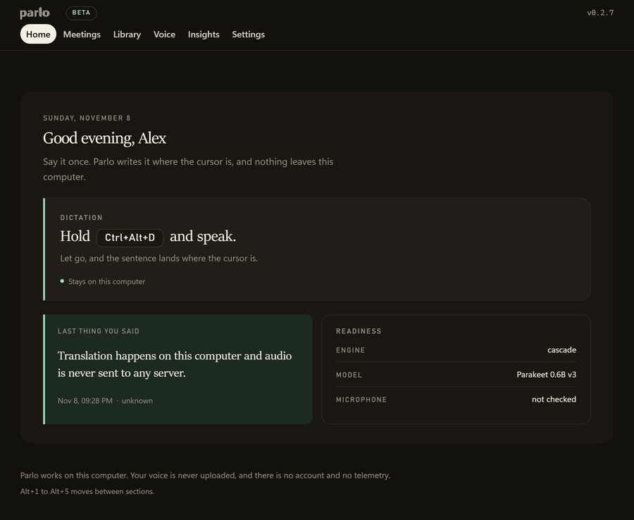

<p align="center">
  
</p>

<p align="center">
  <b>Speech becomes text on your own computer.</b><br>
  Hold a key, speak, and the sentence lands in the window you were already using, cleaned up.<br>
  No account, no telemetry, no audio uploaded.
</p>

<p align="center">
  <a href="https://github.com/PedroNascimento09/Parlo/releases/latest"></a>
  <a href="LICENSE"></a>
</p>

Parlo is a desktop program for dictation, live translation, captions, meetings and file dubbing. The recogniser, the translator and the voice run on the machine, from models downloaded once; after that, dictation, translation and captions work with the network off. Windows is validated end to end today; macOS and Linux build from the same source.

<p align="center">
  
</p>

<p align="center">
  <sub>The window after two Portuguese sentences were dictated and translated into English on this machine: home, the history with both sentences beside their translation, and the counters. Portuguese and English are the shipped pair; the other packs are listed in <a href="docs/LANGUAGES.md">languages</a>.</sub>
</p>

## Install

**Windows**, in PowerShell:

```powershell
irm https://github.com/PedroNascimento09/Parlo/raw/main/scripts/install.ps1|iex
```

Or [download Parlo-Setup.exe](https://github.com/PedroNascimento09/Parlo/releases/latest/download/Parlo-Setup.exe) and double-click it. Either way Parlo lands in `%LOCALAPPDATA%\Programs\Parlo`, adds a Start menu entry and opens the window.

**macOS and Linux:**

```bash
curl -fsSL https://github.com/PedroNascimento09/Parlo/raw/main/scripts/install.sh|bash
```

The build is unsigned, so Windows may show **Windows protected your PC** once: choose **More info**, then **Run anyway**. [Check the download](#check-the-download) shows how to confirm the file before you run it.

The installer carries the programs, not the models. Each model is named with its size before anything moves, and the default recogniser is about 640 MB. That download happens once. `parlo install` and `parlo uninstall` do the same from a terminal, and uninstall keeps your models unless you pass `--purge`.

Updates arrive inside the app, with the release notes beside the button, and a version is always a tagged release, never a commit.

## First run

Open Parlo and the Models panel lists what is missing. Press **Download models** once. The first start takes about twenty seconds while the engine loads, and the window says so rather than looking stuck.

## What you can do

| Task | What happens |
|---|---|
| Dictate into any program | `Ctrl+Alt+D` opens the bar on the monitor with the cursor. Speak and the sentence is typed into the window that had focus as it is recognised; with Polish on, Parlo waits and types the cleaned sentence when you stop. `Ctrl+Alt+Shift+D` keeps listening without holding a key, and `Escape` throws the phrase away. |
| Read while you speak | Live text shows your speech and the translation in two columns, in windows of about 2.5 seconds. `Ctrl+Alt+C` puts the same stream in a thin caption bar over a call or a video. |
| Keep a meeting | Parlo records the room and writes a transcript with a time and a speaker on each line. Rename a speaker once and every line follows. Search it, ask what was decided, jump from an answer to the line and time behind it, and copy all of it as Markdown. |
| Dub a file | Drop a video or audio file and get the same content in the other language, with subtitles synced to the original. The original background can stay under the new voice. |
| Hear the sentence | The translated sentence is read aloud in a local voice for the language it was translated into, in the same window. |
| Teach it names | A local vocabulary fixes the names the recogniser keeps missing, one word at a time, before any model reads the sentence. The history keeps what was said, what was written and the program it landed in, and one click puts a line back on the clipboard. |

## The window

The window is for setup and review. Daily use happens through the shortcut, the bar and the tray.

- **Home** shows whether it is ready, which engine and model it found, whether the microphone opened, and the last sentence with the program it landed in.
- **Meetings** keeps recordings, transcripts and speakers.
- **Library** keeps the files you dub, the batch jobs, the stories and the dictation history.
- **Voice** records a 10 to 30 second sample, seals it with your Windows account if you ask, plays it back, exports it marked as synthetic, or deletes it with the profile.
- **Insights** counts words, minutes and programs, and the last four weeks, from what stays on this computer.
- **Settings** has seven tabs: You, Languages, Dictation, Vocabulary, Models, Shortcuts and Advanced.

The tray lists the three modes above a separator and the five destinations below it, and a left click opens the bar. First-run setup has five steps: your name, the language pair, the microphone, the writing style and the shortcut. Only the name is required, the other steps can be skipped, and setup does not return once finished.

## Shortcuts

| Keys | What happens |
|---|---|
| `Ctrl+Alt+D` | Opens the bar and dictates into the window that had the focus |
| `Ctrl+Alt+Shift+D` | Keeps listening without holding any key |
| `Ctrl+Alt+C` | Opens or closes captions |
| `Ctrl+Alt+Z` | Takes back what the last dictation wrote |
| `Escape` | Discards the phrase, or stops live text, captions or a meeting in progress |

Each key can be changed in Settings. Parlo checks the new combination on save, refuses one that repeats another, and gives the reason when Windows reports it as already taken.

## From the terminal

The same engine answers on the command line, for scripts and for a machine without a window:

```bash
parlo dictate                      # one phrase to the clipboard
parlo listen --play --speaker 3    # the microphone, translated into another output
parlo dub talk.mp4 --srt talk.srt  # a dubbed file and its subtitles
parlo doctor                       # whether capture and engine are healthy
```

The local API is documented in [docs/API.md](docs/API.md), and every command is listed in `parlo --help`.

## Measured

Windows 11, 12-core CPU, no GPU, recogniser on 4 threads. Conditions and every raw line are in [docs/BENCHMARKS.md](docs/BENCHMARKS.md).

| What | Result |
|---|---|
| Dictation, end of audio to text | **379 ms** median on a 5 s clip, with silence trimmed |
| Live segment, recognition to voice | **420.7 ms** mean, 485 ms p95 over a 30 minute run |
| Captions, speech to screen | **about 1.6 s** in a 1.2 s window |
| Streaming, first partial to finished sentence | **849 ms** to **3,355 ms** |
| Recogniser, real-time factor | **0.113** |
| Recognition, 20 European Portuguese sentences | **0.24** word error rate |

No cloud provider number is published here, because none was measured with a real key.

## Privacy

Local mode makes no network call. Audio is not written to disk unless you pass an output path. The local API listens on loopback and uses a token the window generates at each start. The update check is the only call Parlo makes on its own, and it carries no audio and no identifier. A cloud provider is contacted only when you enable it, with your own key, over HTTPS or loopback. History, meetings, vocabulary and voice samples stay in your per-user data folder and can be deleted from the interface. No font, script or image loads from a CDN. [docs/PRIVACY.md](docs/PRIVACY.md) shows how to check this, command by command.

## Where Parlo stands

- Beta. The build is unsigned, there is no signed `.msi`, `.dmg` or `.deb`, and SmartScreen may warn once.
- Windows is validated end to end, window included. macOS and Linux are compiled and tested by CI, but the window has not been opened there.
- The dictation shortcut exists on Windows only; elsewhere the text goes to the clipboard.
- Portuguese and English are the only pairs that install. The language list names others, and Parlo blocks them until their weights, licence and measured quality exist.
- Dictation has been tested with the author's recordings, not with a panel of other speakers.
- Meetings and captions read the microphone, not another app's audio, so routing the translation into a call still needs a virtual cable.
- Read-aloud uses a neutral European Portuguese voice that no listener panel has judged, and no voice is cloned from a sample yet.

## Check the download

Every release ships `SHA256SUMS.txt` and a build provenance record naming the workflow, commit and repository that built it.

```bat
certutil -hashfile Parlo-Setup.exe SHA256
```

Compare the result with the `Parlo-Setup.exe` line in `SHA256SUMS.txt`. With the GitHub CLI logged in, this also checks where the file came from:

```bash
gh attestation verify Parlo-Setup.exe --repo PedroNascimento09/Parlo
```

Neither check replaces code signing, which this build does not have yet. [Windows code-signing reality](docs/WINDOWS_SIGNING_REALITY.md) explains the situation in full.

## Documentation

- [Start here](docs/START.md) walks from a fresh computer to a first dictated sentence.
- [App guide](docs/APP.md) covers the window, the bar, live mode and dubbing.
- [Architecture](docs/ARCHITECTURE.md) and [engines](docs/ENGINES.md) describe how the pieces fit.
- [Models](docs/MODEL_MANAGER.md), [model policy](docs/MODEL_POLICY.md) and [languages](docs/LANGUAGES.md) cover what runs, what it costs and what ships.
- [Benchmarks](docs/BENCHMARKS.md), [dubbing](docs/DUB.md) and [privacy](docs/PRIVACY.md) carry the numbers and the checks.
- [Install](docs/INSTALL.md) has the archive, the Windows script without an installer, and building from source.
- [Troubleshooting](docs/TROUBLESHOOTING.md) and [changelog](CHANGELOG.md) answer the rest.

## Community

- [Contributing](CONTRIBUTING.md) and [governance](GOVERNANCE.md) describe how changes land.
- [Security policy](SECURITY.md) says how to report a vulnerability, and [support](SUPPORT.md) where to ask for help.
- [Code of conduct](CODE_OF_CONDUCT.md) applies to every space this project uses.

## License

The code is **Apache-2.0**. Model weights keep the terms of their own publishers: Parakeet is CC-BY-4.0, the OPUS-MT packages are CC BY 4.0, and the optional Piper adapter is GPL-3.0-or-later, installed separately and never embedded in an archive. [LICENSES.md](LICENSES.md) is the index and [THIRD_PARTY_NOTICES.md](THIRD_PARTY_NOTICES.md) carries the notices.
