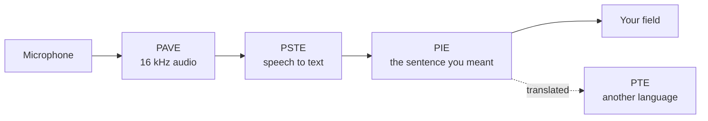

<p align="center">
  
</p>

<p align="center">
  <b>A desktop app that turns speech into clean text, and text into another language.</b><br>
  Everything runs on your machine. No account, no telemetry, no subscription.
</p>

<p align="center">
  <a href="https://github.com/PedroNascimento09/Parlo/actions/workflows/ci.yml"></a>
  
  
  
  
  
</p>

You press one shortcut, speak, and the sentence appears in the field you were already in — typed, not pasted, because Parlo remembers which window had the focus. What gets written is what you meant, not what you said: a correction after "I mean" replaces the words it corrects, hesitations and false starts disappear, and the sentence you actually spoke is kept beside the result.

It speaks two languages so far, Portuguese and English, in both directions, and translates as well as transcribes.

```text
Ctrl+Alt+D  →  "Book a table for Friday, I mean, for Monday."
            →  Book a table for Monday.
```

## What works today

| | |
|---|---|
| **Dictation anywhere** | `Ctrl+Alt+D` shows the island and starts listening; the text is typed into the window you came from, or copied when that window is gone. Working on Windows; macOS and Linux build and translate, but the global shortcut is not there yet and the text goes to the clipboard. |
| **The sentence you meant** | Self-corrections, hesitations, false starts and repetitions fixed on rules alone: **61.9 µs** per sentence, no model, no network, and the original kept beside it. |
| **Cleanup your way** | *Rules only*, *a model on this machine*, *your cloud provider*, or *Automatic*. Cloud is never reached without an explicit switch and a stored key. |
| **Your key, your vault** | OpenAI, Anthropic, Gemini and any OpenAI-compatible server. Keys go to DPAPI, the macOS keychain or the Linux secret service — never a config file, a log or an error message. |
| **Words you actually use** | Names and short forms the recogniser keeps missing, applied before any model reads the sentence, kept in a local file. |
| **Meetings** | Import a transcript with speakers, or record the microphone into one, line by line with timestamps. |
| **Translation and voice** | Portuguese ↔ English offline, with a neutral voice; dubbing a video with subtitles works too. |
| **Free when idle** | Loaded models are released after 10 minutes to 4 hours of silence — or never, your choice. |

## Install

**From a release — no Python, no Rust.** Download the archive for your platform, unpack it, double-click `parlo-app`, let it fetch about 800 MB of models once. After that it is offline for good.

```text
parlo-windows-x86_64.zip     parlo-macos-aarch64.tar.gz     parlo-linux-x86_64.tar.gz
```

**From source** — Rust 1.85 or newer, nothing else.

```bash
cargo build --release -p parlo-cli -p parlo-app
target/release/parlo-app
```

`parlo install` copies it into your user folder with a menu entry. `parlo update` replaces the running copy in place, and the window offers every new release with its notes and an **Install update** button — no version is ever installed by uninstalling the old one.

## See it

<p align="center">
  <br>
  <sub>Animated by <code>tools/brand.py</code> — a diagram of the real path, not a screen recording.</sub>
</p>

<p align="center">
  <br>
  <sub>The island after a correction was resolved and the text was typed where you were.</sub>
</p>

Two more pictures, both generated from the same script: [the pipeline](assets/pipeline.png) and [the banner](assets/banner.png).

## Measured

Windows 11 laptop, no GPU, 4 threads, warm process. Conditions and raw rows in [docs/BENCHMARKS.md](docs/BENCHMARKS.md) — nothing here is a promise about a machine nobody ran it on.

| What | Result |
|---|---|
| Cleanup rules, 10 sentences × 1 000 runs | **61.9 µs** mean, 102.1 µs p95 |
| One segment through the cascade, recognition included | **420.7 ms** mean, 485 ms p95 |
| Thirty minutes of audio, 1 095 segments | no drift, no errors; the last ten cycles 58 ms faster than the first |
| Streaming, first partial to final text | **849 ms** to **3 356 ms**, word error rate **0.231** |
| Real time factor, Parakeet v3 int8 on 4 threads | **0.11** |
| Cold start with every model | **18.1 s** |

Not measured, and claimed nowhere: any cloud provider's latency or price. No live request to one has been made with a real key.

## How it differs

| | Native call translation | Parlo |
|---|---|---|
| Works in | Only that app | Any field, any app that takes keyboard input |
| Audio leaves the machine | Yes | **No in local mode** |
| Cost | Paid plan | **Free**, on your hardware |
| The other side needs an account | Usually | **No** |
| Cloud AI | Required | Optional, your key, off by default |
| Languages | Many | Two today, grown by the community |

## How it works



Each engine owns one responsibility: **PAVE** the audio, **PSTE** recognition, **PIE** the text, **PTE** translation, **PIMO** which model runs and when it leaves memory, **PME** what is remembered. The model side is a Python sidecar behind a newline-delimited JSON protocol, so a model crash cannot take the window down; the app itself is Rust with a Tauri shell. Details: [docs/ARCHITECTURE.md](docs/ARCHITECTURE.md).

## Privacy

- Local mode makes no network call. No telemetry, no accounts, no crash reporting.
- Audio is never written to disk unless you pass an output path.
- A provider is reached only when you allow it, store a key and pick it — over HTTPS or loopback, straight from your machine. There is no Parlo server in the middle.
- History, meetings and vocabulary stay in your user data folder, and each can be deleted from the interface.

Verify it yourself: [docs/PRIVACY.md](docs/PRIVACY.md).

## Build and test

```bash
cargo fmt --all --check
cargo clippy --workspace --all-targets -- -D warnings
cargo test --workspace

cd engines/cascade && PYTHONPATH=. python -m unittest discover -s tests
```

CI runs those on Linux, macOS and Windows, alongside the licence gate that keeps every artefact's terms in [LICENSES.md](LICENSES.md).

## Roadmap

The next release is **v0.2.0**: cloud cost control, per-model unload rules in the interface, and Ask Parlo over past meetings. Then **v0.3 Listen** decides with data before adding features, and the plan stops at **v0.5 Write in another language** — any supported language into the active field, with a measured quality gate rather than a promise. Milestones in [ROADMAP.md](ROADMAP.md) are labels; releases live in [docs/releases](docs/releases) and are announced inside the app.

## Docs

[App guide](docs/APP.md) · [Architecture](docs/ARCHITECTURE.md) · [Engines](docs/ENGINES.md) · [Benchmarks](docs/BENCHMARKS.md) · [Intelligence engine](docs/INTELLIGENCE.md) · [Glossary](PARLO_GLOSSARY.md) · [Privacy](docs/PRIVACY.md) · [Troubleshooting](docs/TROUBLESHOOTING.md) · [Licences](docs/LICENSES.md)

## Contributing

Issues and pull requests are welcome. The three smallest useful things right now: a hardware report from your own machine, a recording in your accent, or a translation of this page into a language you speak. Start with [CONTRIBUTING.md](CONTRIBUTING.md) and look for `good first issue`.

## Licence

The code is **Apache-2.0**: commercial use, modification and redistribution allowed, with a patent grant. Model weights keep their publishers' terms — Parakeet is CC-BY-4.0, the OPUS-MT packages are CC BY 4.0 — and the optional Piper adapter is GPL-3.0-or-later, installed separately and never shipped in an archive. [LICENSES.md](LICENSES.md) is the index, [THIRD_PARTY_NOTICES.md](THIRD_PARTY_NOTICES.md) carries the notices, and [docs/LICENSES.md](docs/LICENSES.md) explains the split.

<p align="center"><sub>Parlo is independent and unaffiliated with any company it interoperates with. The speech-to-speech approach builds on <a href="https://github.com/kyutai-labs/hibiki">Hibiki-Zero</a> by Kyutai, used as an optional engine under its own licence.</sub></p>
