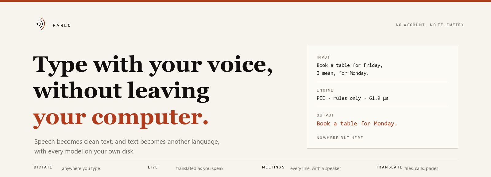
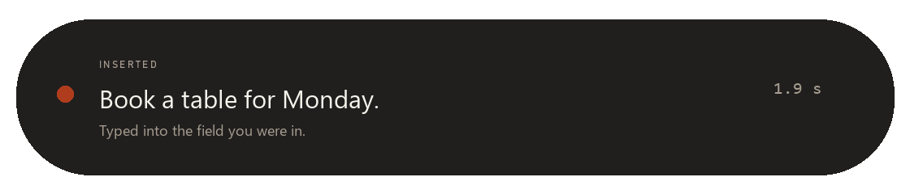
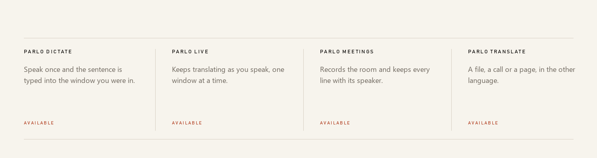
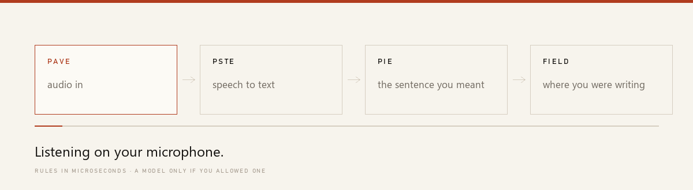
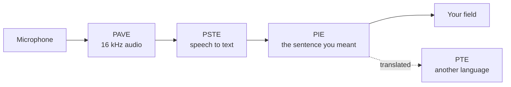

<p align="center">
  
</p>

<p align="center">
  <br>
  <b>Parlo turns speech into clean text, and text into another language, on your own computer.</b><br>
  Windows, macOS and Linux. No account, no telemetry, no subscription.
</p>

<p align="center">
  <a href="https://github.com/PedroNascimento09/Parlo/actions/workflows/ci.yml"></a>
  
  
  
</p>

You press one shortcut, speak, and the sentence appears in the field you were already in — typed, not pasted, because Parlo remembers which window had the focus. What gets written is what you meant, not what you said: a correction after "I mean" replaces the words it corrects, hesitations and false starts disappear, and the sentence you actually spoke is kept beside the result.

```text
Ctrl+Alt+D  →  "Book a table for Friday, I mean, for Monday."
            →  Book a table for Monday.
```

## Introducing Parlo

Four surfaces, one engine underneath. Every one of them is in the current release.

<p align="center">
  <br>
  <sub>Parlo Dictate: the sentence it wrote, in the field it came from.</sub>
</p>

<p align="center">
  
</p>

- **Parlo Dictate** — one shortcut, anywhere: the island listens, the sentence is written where you were.
- **Parlo Live** — continuous translation while you speak, one window at a time, spoken back in the other language.
- **Parlo Meetings** — a transcript imported or recorded from the room, every line with its moment and its speaker.
- **Parlo Translate** — a file dubbed with subtitles, or a sentence in the other language, offline.

## What it does

- **The sentence you meant.** Self-corrections, false starts, hesitations and accidental repetitions are fixed on rules alone: **61.9 µs** per sentence, no model, no network. Your words are kept beside the result.
- **A choice of engine.** Rules only, a model on this machine, your cloud provider, or automatic. Cloud is never reached without an explicit switch and a key you stored.
- **Your key stays yours.** OpenAI, Anthropic, Gemini and any OpenAI-compatible server; keys go to DPAPI, the macOS keychain or the Linux secret service — never a config file, a log or an error message.
- **Words you actually use.** Names and short forms the recogniser keeps missing, applied before any model reads the sentence, kept in a local file.
- **Nothing held longer than needed.** Loaded models are released after 10 minutes to 4 hours of silence — or never, your choice.

## Install

**From a release — no Python, no Rust.** Download the archive for your platform, unpack it, double-click `parlo-app`, and let it fetch about 800 MB of models once. After that it is offline for good.

```text
parlo-windows-x86_64.zip      parlo-macos-aarch64.tar.gz      parlo-linux-x86_64.tar.gz
```

**From source** — Rust 1.85 or newer, nothing else.

```bash
cargo build --release -p parlo-cli -p parlo-app
target/release/parlo-app
```

`parlo install` copies it into your user folder with a menu entry. `parlo update` replaces the running copy in place, and the window offers every new release with its notes and an **Install update** button — no version is ever installed by uninstalling the old one.

## The path

<p align="center">
  <br>
  <sub>Animated by <code>tools/brand.py</code>: a diagram of the real path, not a screen recording.</sub>
</p>

Each engine owns one responsibility, and the names are fixed in the [glossary](PARLO_GLOSSARY.md): **PAVE** the audio, **PSTE** recognition, **PIE** the text, **PTE** translation, **PIMO** which model runs and when it leaves memory, **PME** what is remembered.

## Measured

Windows 11 laptop, no GPU, 4 threads, warm process. Conditions and raw rows in [docs/BENCHMARKS.md](docs/BENCHMARKS.md) — nothing here is a promise about a machine nobody ran it on.

| What | Result |
|---|---|
| Cleanup rules, 10 sentences × 1 000 runs | **61.9 µs** mean, 102.1 µs p95 |
| One segment through the cascade, recognition included | **420.7 ms** mean, 485 ms p95 |
| Thirty minutes of audio, 1 095 segments | no drift, no errors; the last ten cycles 58 ms faster than the first |
| Streaming, first partial to final text | **849 ms** to **3 356 ms**, word error rate **0.231** |
| Real time factor, Parakeet v3 int8 on 4 threads | **0.11** |
| Cold start with every model | **18.1 s** |

Not measured, and claimed nowhere: any cloud provider's latency or price. No live request to one has been made with a real key.

## How it compares

| | Native call translation | Parlo |
|---|---|---|
| Works in | Only that app | Any field, any app that takes keyboard input |
| Audio leaves the machine | Yes | **No in local mode** |
| Cost | Paid plan | **Free**, on your hardware |
| The other side needs an account | Usually | **No** |
| Cloud AI | Required | Optional, your key, off by default |
| Languages | Many | Two today, grown by the community |

## Under the hood



The model side is a Python sidecar behind a newline-delimited JSON protocol, so a model crash cannot take the window down. The app is Rust with a Tauri shell and a page served on loopback; the core crate has no dependencies. Details: [docs/ARCHITECTURE.md](docs/ARCHITECTURE.md).

## Privacy

- Local mode makes no network call. No telemetry, no accounts, no crash reporting.
- Audio is never written to disk unless you pass an output path.
- A provider is reached only when you allow it, store a key and pick it — over HTTPS or loopback, straight from your machine. There is no Parlo server in the middle.
- History, meetings and vocabulary stay in your user data folder, and each can be deleted from the interface.

Verify it yourself: [docs/PRIVACY.md](docs/PRIVACY.md).

## What is not there yet

- The dictation shortcut is Windows-only; on macOS and Linux the text goes to the clipboard.
- Two languages, Portuguese and English. German is published as **not validated** by a native speaker.
- Dictation is tested, not yet validated with real recordings by people other than the author.
- The archives are unsigned: SmartScreen asks once, and there is no installer.
- Meetings capture the microphone, not the sound of another application.

## Build and test

```bash
cargo fmt --all --check
cargo clippy --workspace --all-targets -- -D warnings
cargo test --workspace

cd engines/cascade && PYTHONPATH=. python -m unittest discover -s tests
```

CI runs those on Linux, macOS and Windows, alongside the licence gate that keeps every artefact's terms in [LICENSES.md](LICENSES.md). The visuals are generated, not hand-exported: `python tools/brand.py`.

## Roadmap

The next release is **v0.2.0**: cloud cost control, per-model unload rules in the interface, and Ask Parlo over past meetings. Then **v0.3 Listen** decides with data before adding features, and the plan stops at **v0.5 Write in another language** — any supported language into the active field, with a measured quality gate rather than a promise. Milestones in [ROADMAP.md](ROADMAP.md) are labels; releases live in [docs/releases](docs/releases) and are announced inside the app.

## Docs and contributing

[App guide](docs/APP.md) · [Architecture](docs/ARCHITECTURE.md) · [Engines](docs/ENGINES.md) · [Benchmarks](docs/BENCHMARKS.md) · [Intelligence engine](docs/INTELLIGENCE.md) · [Glossary](PARLO_GLOSSARY.md) · [Privacy](docs/PRIVACY.md) · [Troubleshooting](docs/TROUBLESHOOTING.md) · [Licences](docs/LICENSES.md)

Issues and pull requests are welcome. The three smallest useful things right now: a hardware report from your own machine, a recording in your accent, or a translation of this page into a language you speak. Start with [CONTRIBUTING.md](CONTRIBUTING.md) and look for `good first issue`.

## Licence

The code is **Apache-2.0**: commercial use, modification and redistribution allowed, with a patent grant. Model weights keep their publishers' terms — Parakeet is CC-BY-4.0, the OPUS-MT packages are CC BY 4.0 — and the optional Piper adapter is GPL-3.0-or-later, installed separately and never shipped in an archive. [LICENSES.md](LICENSES.md) is the index, [THIRD_PARTY_NOTICES.md](THIRD_PARTY_NOTICES.md) carries the notices, and [docs/LICENSES.md](docs/LICENSES.md) explains the split.

<p align="center"><sub>Parlo is independent and unaffiliated with any company it interoperates with. The speech-to-speech approach builds on <a href="https://github.com/kyutai-labs/hibiki">Hibiki-Zero</a> by Kyutai, used as an optional engine under its own licence.</sub></p>
